# lucasCore User Guide

*A snapshot of the lucasCore User Guide, exported 2026-10-29. Also as a [web page](https://bsleeter.github.io/lucasCore/guide/), beside the [package](https://bsleeter.github.io/lucasCore/blueprint/) and [data](https://bsleeter.github.io/lucasCore/blueprint/data.html) blueprints.*

How to build and run a LUCAS land-use and carbon model with the lucasCore SyncroSim package, walked through on the Northern Sierra Nevada pyrome (P26) at 150 m.

## About this guide

This guide builds and runs a LUCAS land-use and carbon model with the lucasCore package for SyncroSim, from an empty library to carbon projections. The worked example is the Northern Sierra Nevada pyrome (P26) at 150 m, built from 1985 to 2023 and projected to 2100.

It is for modelers who know SyncroSim's basics (libraries, projects, scenarios, results) and ST-Sim's state-and-transition ideas, but not this package. The science behind each stage is in the lucasCore plan and the stage scripts; this guide covers what to click, what to enter and what to check.

**Conventions**

- **Screen captures.** Each step that changes a setting shows the Studio window with the field outlined. Captures are taken from SyncroSim Studio 3.1 on Windows.
- **Opening settings.** Library, project and scenario settings each open with a **double-click** on that item in the Explorer tree: the library (top line), the **Definitions** project under it, or a scenario under the project. The settings open as a tab on the right, with their own tabs across the top (General, LUCAS Core (model builder), ST-Sim, System) and a tree of pages on the left. Paths in this guide read tab > tree item, for example LUCAS Core (model builder) > LUCAS Core > Data Sources.
- **Scenario descriptions.** Every scenario gets a written description (double-click the scenario, General tab, Description) recording its purpose, dependencies, key settings and assumptions. Each chapter shows the P26 version.
- **Names.** Scenarios are named `<area> - <step>`, for example `P26 Northern Sierra Nevada - Build`, `P26 Northern Sierra Nevada - Historical 1985-2023`, `P26 Northern Sierra Nevada - Projection Setup`. SyncroSim names results after their parent with a run time stamp.
- **Result IDs.** Dependencies point at results, not at the scenarios that made them. Write down each result's ID as you go; later steps ask for them.
- **Preparation and runs.** lucasCore scenarios come in two kinds. Preparation scenarios run lucasCore stages and write the inputs a model needs (the Build, the Projection Setup). Runs are ST-Sim alone, with dependencies that supply every input (the historical run, each projection). Real runs are always stand-alone in this way.
- **Package version.** Written for lucasCore 1.0.0 on SyncroSim 3.1 with ST-Sim 4.5.

**The workflow in one line.** Build (stages 1-8) → Historical run (ST-Sim) → Projection Setup (stages 9-10, with the hand-over from the historical run) → Projections (ST-Sim, as many as needed).

## 1. Getting started

A lucasCore model lives in a SyncroSim library (`.ssim` file) that uses two packages: ST-Sim, which runs the state-and-transition and carbon simulation, and lucasCore, which builds everything ST-Sim needs from national data. This chapter installs lucasCore and makes the library.

**Before you start**

- SyncroSim Studio 3.1 or later, installed in `C:\Program Files\SyncroSim`, with the ST-Sim package (4.5.4 or later).
- R 4.6 with the packages rsyncrosim, terra, sf, data.table, mgcv and jsonlite. SyncroSim runs every lucasCore stage in R; lucasCore needs no conda environment.
- The national data on a local drive (section 1.5 lists each source).
- The lucasCore package file, lucasCore-1.0.0.ssimpkg, (section 1.1).

### 1.1 Install the package

SyncroSim keeps one list of installed packages for the whole computer. lucasCore is installed once, from its package file `lucasCore-1.0.0.ssimpkg`, then used by every library made from the starter.

1. Open the **File** menu.
2. Choose **Local Packages**.

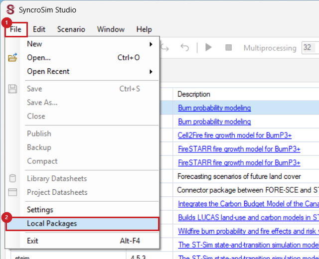

*Figure 1.1. File > Local Packages.*

The **Local Packages** tab lists every package installed on this computer, with its version.

3. At the bottom of the tab, click **Install from File...**.

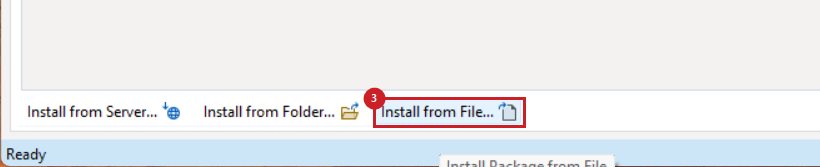

*Figure 1.2. The Local Packages tab. Install from File... is at the bottom left.*

4. In the **Open** dialog, go to the folder holding the package file and select `lucasCore-1.0.0.ssimpkg`.
5. Click **Open**.

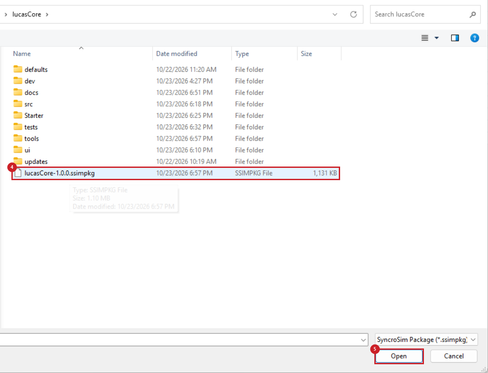

*Figure 1.3. Choose the lucasCore package file.*

6. Check that **lucasCore 1.0.0** now appears in the list (outlined), with **stsim 4.5.4** or later. ST-Sim must be installed too: if it is missing, install it with **Install from Server...**.

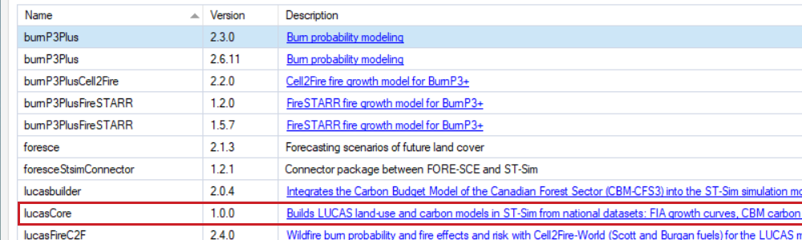

*Figure 1.4. lucasCore 1.0.0 in the Local Packages list.*

> Several versions of a package can sit side by side in this list (stsim 4.3.8, 4.5.3 and 4.5.4 above). Each library records the version it uses.

> **For package developers.** To run lucasCore straight from a source folder, so that edits to its scripts take effect without reinstalling, register the folder instead, with Studio closed: `"C:\Program Files\SyncroSim\SyncroSim.PackageManager.exe" --xinstall="F:\lucasCore"`. Never edit the folder while a scenario is running. `tools\build_ssimpkg.ps1` makes the package file from the committed source.

### 1.2 Create an empty library

1. Open the **File** menu.
2. Choose **New**.
3. Choose **Empty Library...**.

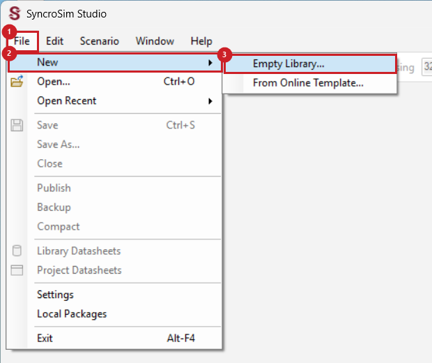

*Figure 1.5. File > New > Empty Library.*

4. In the dialog that opens, give the library a name and a folder. For the example: folder F:\\lucasCore\\dev\\libs, name `LUCAS P26 Northern Sierra Nevada`.
5. Click **OK**. The library opens in the Explorer with one project, **Definitions**, holding one empty scenario, **\[1\] New Scenario**. Chapter 3 makes it the Build.

![The Explorer of the new library: LUCAS P26 Northern Sierra Nevada marked 5, its Definitions project, and \[1\] New Scenario outlined](images/fig-1.6.png)

*Figure 1.6. The new library in the Explorer, with its Definitions project and one empty scenario.*

### 1.3 Add ST-Sim first, then lucasCore

An empty library has no packages. lucasCore is an add-on to ST-Sim and needs ST-Sim's datasheets to be in the library before it is added. The Add Package dialog takes one package at a time, so this is two separate adds, in this order:

> **Order matters: add stsim first, then lucasCore.**
>
> 1. Add **stsim**, and click OK.
> 2. Then add **lucasCore**, and click OK.
>
> Added before stsim, lucasCore warns about missing datasheets, is not added, and its project definitions are never written. If that happens, close the library and start again from a new empty library (section 1.2).

Open the library's settings: **double-click the library** (the top line) in the Explorer.

1. On the **General** tab, choose **Packages**. The list is empty.
2. Click **Add...**.

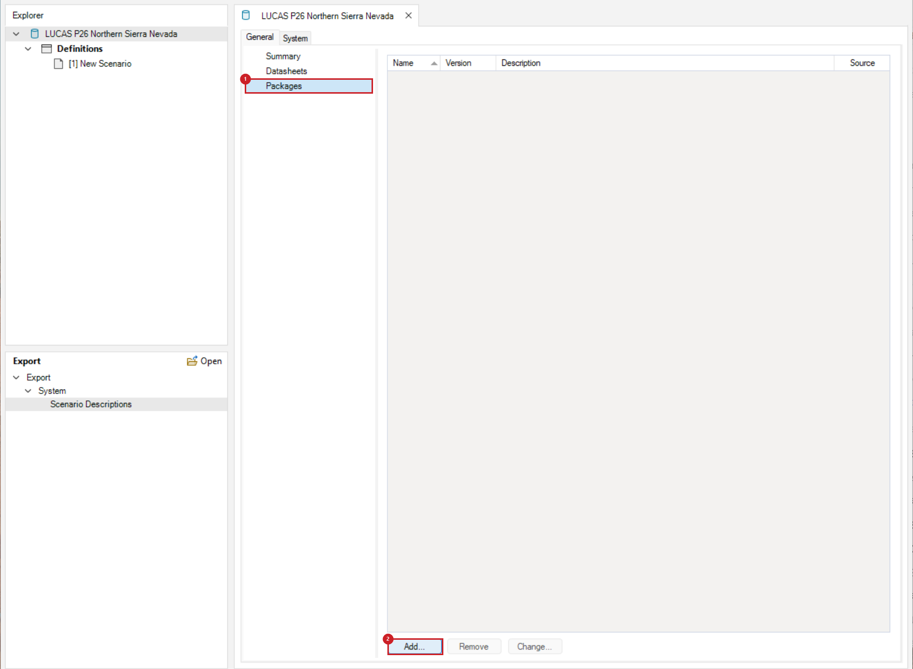

*Figure 1.7. The library's Packages list, empty in a new library.*

3. In the **Add Package** dialog, tick **stsim**.
4. Click **OK**.

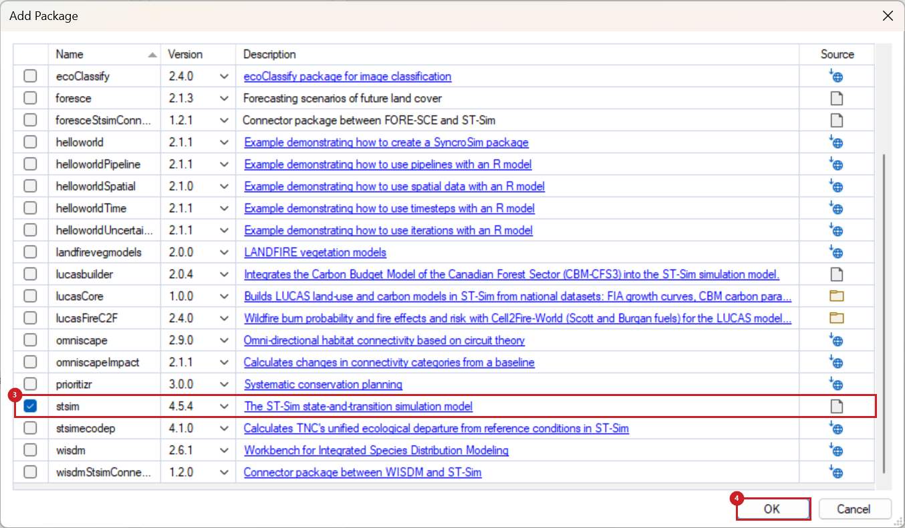

*Figure 1.8. Add ST-Sim first.*

5. Click **Add...** again.
6. Tick **lucasCore**.
7. Click **OK**. lucasCore now fills the Definitions project, which takes a few seconds.

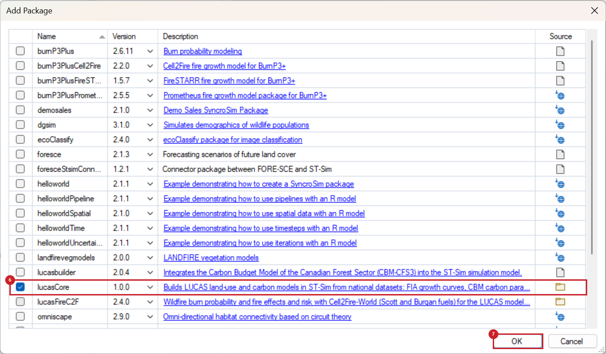

*Figure 1.9. Then add lucasCore.*

8. Check that the list shows **lucasCore 1.0.0** and **stsim 4.5.4** (outlined).

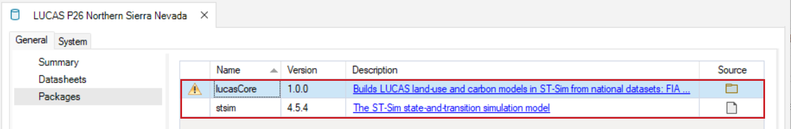

*Figure 1.10. Both packages in the library.*

> **The warning icon.** A package installed from a folder shows a warning triangle: SyncroSim reports it was "built for an undetermined version of SyncroSim". It does not affect runs and can be ignored. A package installed from its `.ssimpkg` file (section 1.1) carries its SyncroSim version.

When lucasCore is added, it fills the **Definitions** project with everything a lucasCore model shares. To check:

1. Double-click the **Definitions** project in the Explorer to open its properties.
2. Choose the **ST-Sim** tab.
3. Choose **States > State Class**. The list holds the model's 51 state classes.

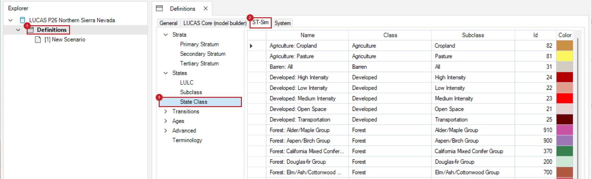

*Figure 1.11. The state classes lucasCore wrote into the new library.*

| What | Where to see it (Definitions project properties) | Rows |
| --- | --- | --- |
| Primary strata: the FIA ecodivisions | ST-Sim > Strata > Primary Stratum | 19 |
| Secondary and tertiary strata: every unit of every Stratum Source | ST-Sim > Strata > Secondary Stratum, Tertiary Stratum | 6,221 each |
| State classes, from NLCD land cover and FIA forest type groups | ST-Sim > States > State Class | 51 |
| Transition types and groups: land use, harvest, fire, insects | ST-Sim > Transitions | 143 types, 15 groups |
| Stock and flow types: the 14 carbon pools and their flows | ST-Sim > Advanced | 23 stocks, 54 flows |
| Stratum Sources (states, counties, HUCs, ecoregions, pyromes, federal lands, GAP status) | LUCAS Core (model builder) > LUCAS Core > Stratum Sources | 9 |
| LOCA2 climate scenarios, models and replicates | LUCAS Core (model builder) > LUCAS Core | 3, 10 and 6 |

lucasCore also fills two lists that the Carbon Assumptions pages (chapter 3) pick from: the CBM-CFS3 ecozones and species types, with the turnover and decay rates each one sets.

4. Click the **LUCAS Core (model builder)** tab.
5. Click **CBM Ecozones**: 15 ecozones (**CBM Species Types** holds 194 species types).

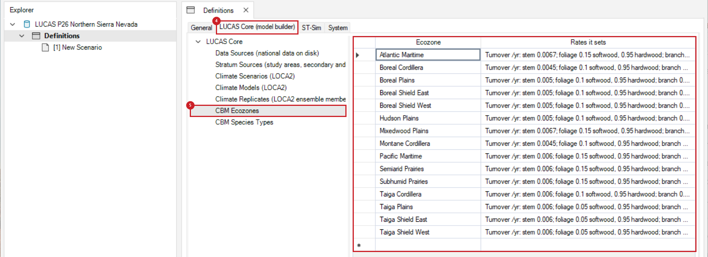

*Figure 1.12. The CBM-CFS3 ecozones lucasCore wrote into the new library.*

> There is no Stock-Flow Definitions scenario: the flow order, flow diagram and group memberships are scenario data, and stage 0 of the Build writes them into the Build result (chapter 3), where every run finds them.

### 1.4 Library settings

Open the library's properties (double-click the library in the Explorer).

1. Choose the **System** tab.
2. Choose **Multiprocessing > General**.
3. Leave **Enable multiprocessing** unticked for now. The Build stages read and write whole national grids and run one at a time; chapter 8 turns multiprocessing on for runs.

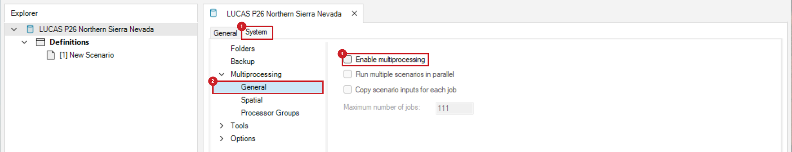

*Figure 1.13. Multiprocessing stays off for the Build.*

4. Choose **Tools > R**.
5. Check that **Run directly** is selected and that **R executable** points at R 4.6, here `C:\Program Files\R\R-4.6.1\bin\Rscript.exe`. Use **Browse...** if it points elsewhere.

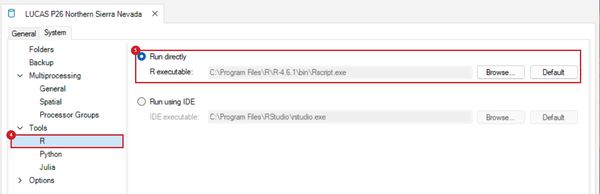

*Figure 1.14. Every lucasCore stage runs in this R.*

### 1.5 Data Sources

The stages read national data from disk. The paths are set once per library, in the project's Data Sources sheet.

1. In the Definitions project's settings, choose the **LUCAS Core (model builder)** tab.
2. Choose **LUCAS Core > Data Sources**. The datasets are grouped by kind: study area and strata, land cover, forest inventory and age, disturbance and fire, climate, soils and terrain, infrastructure and ownership. Hover a dataset's name for its full description, source and download link; a grey note under a name says when it is needed.
3. Each dataset has a path box. A new library comes with every path filled in: they are where the data sit on the machine lucasCore was built on (F:/lucas-master/Data Sources/...). A long path shows its end; hover it for the whole path. Change each one to where your copy lives: type or paste the path, or
4. click **Browse...** to pick the file or folder.
5. **Download** opens the page where the dataset can be downloaded. Datasets in the USFS Research Data Archive open the archive and name their RDS identifier.
6. The mark at the end shows whether the path exists on this machine: a green tick, or a red cross for a path that must still be fixed. The gNATSGO Crop Productivity path is the one exception: leave it blank (the mark reads "fetched") and stage 10 fetches the layer for you.

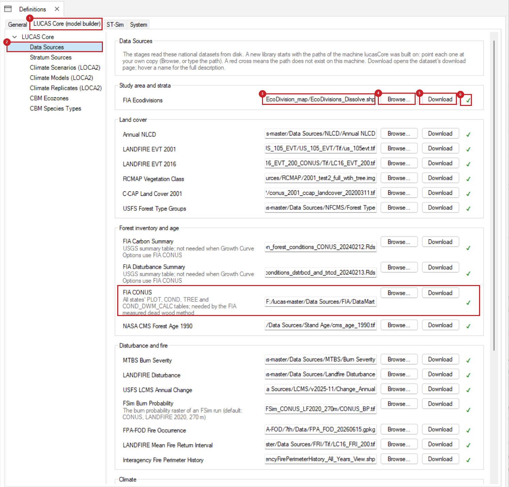

*Figure 1.15. Data Sources in a new library, filled with the paths of the machine lucasCore was built on. Change each one to where the data sit on yours.*

The sources, and what each is used for:

| Source | Used for |
| --- | --- |
| FIA Ecodivisions | Primary strata and the model lattice (stage 1) |
| FIA Carbon Summary and FIA Disturbance Summary (USGS condition tables; not needed with FIA CONUS) | Growth curves and carbon calibration (stages 2-3) |
| FIA CONUS: the FIA DataMart tables of all states (PLOT, COND, TREE, COND\_DWM\_CALC, FIADB\_REFERENCE; about 15 GB) | Dead wood calibration, FIA measured dead wood method (stage 3); optional source for growth curves (stage 2) |
| Annual NLCD | Land cover and land-use change, 1985 onward (stages 5-6) |
| LANDFIRE EVT 2001 and 2016, RCMAP, C-CAP, USFS forest type groups | Forest type and non-forest cover detail (stage 5) |
| NASA CMS Forest Age 1990 | Initial stand age (stage 5) |
| USFS LCMS annual change | Clearcut and partial harvest (stages 6 and 10) |
| MTBS burn severity, interagency fire perimeters | Historical fire and fire sizes (stages 6 and 9) |
| LANDFIRE disturbance, mean fire return interval | Spin-up return intervals and disturbance detail (stages 4-6) |
| FSim burn probability, FPA-FOD | Projected fire placement and ignitions, fire method 2 (stage 9) |
| PRISM, LOCA2 | Historical and projected climate multipliers (stage 7) |
| gSSURGO soil organic carbon | Soil carbon targets (stage 3) |
| Roads, elevation, SILVIS WUI, NCCPI, forest ownership | Suitability surfaces for projected land use and harvest (stage 10) |

> A blank NCCPI path is fine: stage 10 fetches the crop productivity layer for the fitting region from Planetary Computer and caches it.

## 2. How a model is built and run

A lucasCore model is a chain of scenarios. Two **preparation** scenarios run lucasCore stages and write inputs; **runs** are ST-Sim alone and take every input from their dependencies. A dependency supplies whole data feeds, so the order of a scenario's dependencies matters: where two dependencies hold the same feed, the one listed first wins.

[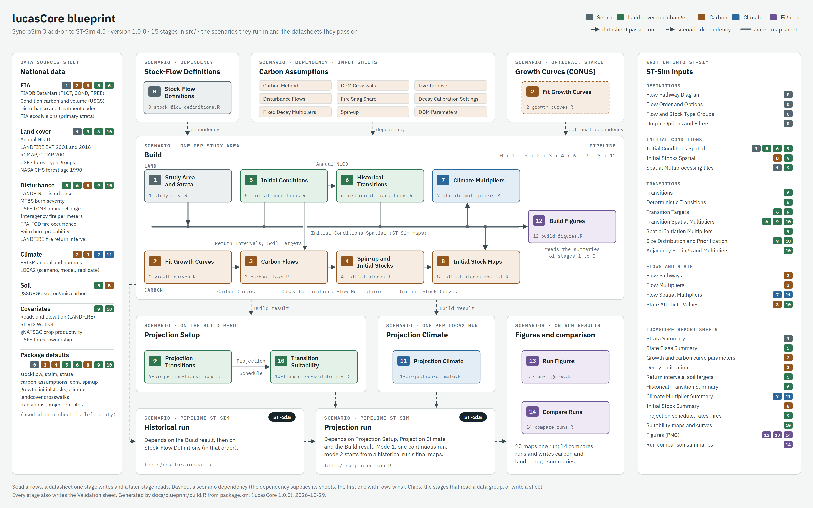](https://bsleeter.github.io/lucasCore/blueprint/)

*The scenario chain, from the [package blueprint](https://bsleeter.github.io/lucasCore/blueprint/) (the interactive diagram of the guide's Claude Doc does not export).*

The Build is made once per study area. The historical run is made once per Build. A Projection Setup is made once per historical run it starts from and per set of projection rules; any number of projections (climate scenarios, iterations, years) then run on it.

| Scenario | Pipeline | Dependencies, in order | Writes |
| --- | --- | --- | --- |
| Build | stages 0, 1, 5, 2, 3, 4, 6, 7, 8 | none | Stock-flow definitions, strata and initial conditions, growth curves, carbon flows, spin-up stocks, historical transitions, historical (PRISM) climate multipliers, initial stock maps |
| Historical run | ST-Sim | Build result | Land cover, transitions and carbon, start to end year |
| Projection Setup | stages 9, 10 | Build result | Projection transitions and fire to the end year in Run Settings, suitability surfaces, and the historical run's final state as the projection's starting maps |
| Projection Climate (one per climate future) | stage 11 | Build result | Climate multipliers of the projection years from one LOCA2 scenario, climate model and replicate |
| Projection | ST-Sim | Projection Setup result, Projection Climate result, Build result | Land cover, transitions and carbon, historical end to projection end |

> Why runs stand alone: an ST-Sim-only scenario can be rerun, copied for another climate scenario and run side by side with others under multiprocessing (chapter 8). A scenario that runs lucasCore stages and then ST-Sim in one pipeline cannot run beside other scenarios.

**Times for P26 at 150 m.** Use these to plan; finer cells or larger areas take longer.

| Step | Time |
| --- | --- |
| Build | timed in chapter 4 |
| Historical run, 1985-2023, one iteration | about 8 hours |
| Projection Setup | timed in chapter 6 |
| Projection | about 12 minutes per simulated year per iteration, less with multiprocessing |

## 3. The Build scenario

The Build turns national data into everything an ST-Sim run needs for one study area: the model grid and strata, state class and age maps, growth curves, carbon flows and spin-up stocks, historical transitions, climate multipliers and the initial carbon stock maps. Its settings open with a **double-click on the scenario** in the Explorer, on the **LUCAS Core (model builder)** tab.

### 3.1 Name, describe and set up the scenario

1. In the Explorer, **double-click \[1\] New Scenario**, the empty scenario Studio made with the library. (In a library that has none, right-click the Definitions project and choose **New > Scenario**.) Its settings open as a tab, on the **General** tab, **Summary** page.
2. In **Name**, type `P26 - Build`.
3. In **Description**, record what the scenario is for and its key settings. For the example:

```
Build for the Northern Sierra Nevada pyrome (P26) at 150 m, 1985-2023, historical only.
Strata: primary FIA ecodivisions; secondary Counties, tertiary Federal Lands. Forest types from the USFS forest type group maps.
Climate: tree-ring forest growth, Miami NPP non-forest growth, Q10 decomposition.
Carbon: FIA measured dead wood, gSSURGO soil (Carbon Assumptions pages). Growth curves fitted in this Build (stage 2).
Dependencies: none. Pipeline: stages 0, 1, 5, 2, 3, 4, 6, 7, 8.
```

![The Build scenario settings, General tab, Summary page: the scenario \[1\] P26 - Build marked 1, Name P26 - Build marked 2, and the description marked 3](images/fig-3.1.png)

*Figure 3.1. The Build's name and description.*

4. Choose **Pipeline**.
5. Add the stages, one per row, by picking each from the **Stage** list: **0 - Stock-Flow Definitions**, **1 - Study Area and Strata**, **5 - Initial Conditions**, **2 - Fit Growth Curves**, **3 - Carbon Flows**, **4 - Spin-up and Initial Stocks**, **6 - Historical Transitions**, **7 - Climate Multipliers**, **8 - Initial Stock Maps**. Run Order numbers them 1 to 9.

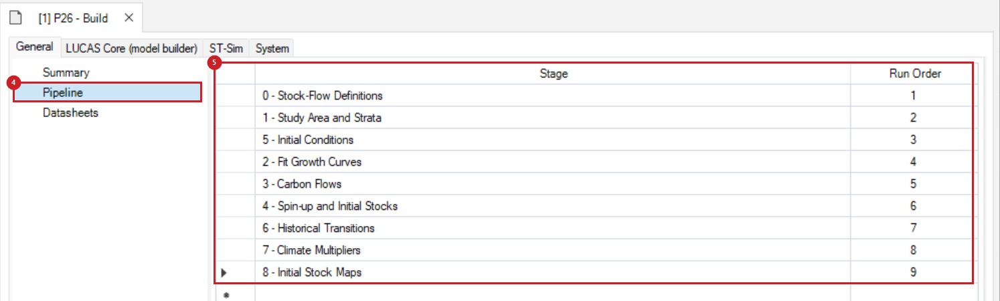

*Figure 3.2. The Build pipeline.*

> Stage 5 runs before stage 2: stage 2 needs only the study area, while stages 3 and 4 need stage 5's maps. Leave stage 2 out when growth curves are copied from another library (section 3.5). The Build needs no dependencies: its carbon assumptions are set on its own Carbon Assumptions pages (section 3.6).

> Stage 0 writes the fixed LUCAS stock-flow definitions (flow diagram, flow order, stock and flow group memberships, output options) into the Build result, so every run that depends on the Build gets them. Libraries copied from the older starter have a Stock-Flow Definitions scenario instead; stage 0 then finds the definitions already there and writes nothing.

### 3.2 Study Area

The study area is one or more units of one kind: states, counties, HUCs, EPA ecoregions, pyromes, ecodivisions, federal lands or GAP status. All of CONUS is the default.

1. Choose the **LUCAS Core (model builder)** tab.
2. Choose **LUCAS Core > Study Area**.
3. In **Define the study area by**, pick the kind of unit from the drop-down: **Pyromes**.
4. Type or pick the unit in the box below, here **P26 Northern Sierra Nevada**.
5. Click **Add**. The unit appears in the list (outlined), and the line at the bottom of the page reads "Study area: 1 unit". Add more units of the same kind to build a larger area; **Remove** takes the selected one out. Changing the kind of unit clears the list.

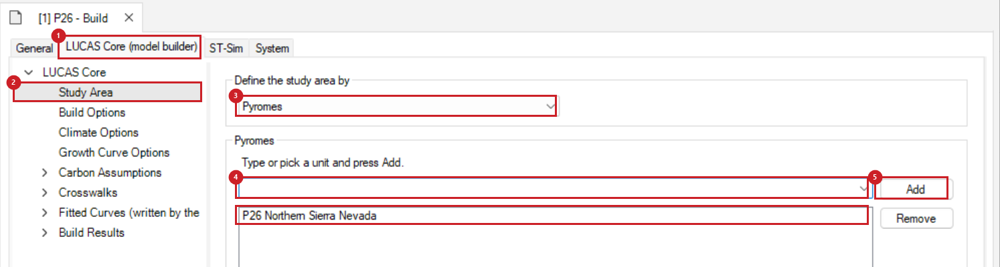

*Figure 3.3. P26 Northern Sierra Nevada as the study area.*

### 3.3 Build Options

1. Choose **Build Options**.
2. **Cell size (m)**: `150`. A finer grid takes longer in every stage and every run; at 150 m a pyrome runs about 12 minutes per simulated year.
3. **Historical period**: start year `1985`, end year `2023`. Land use, disturbance and climate come from these years' data. Projections start the year after the end year; their end year is set in the Projection Setup (chapter 6) and their climate in a Projection Climate scenario, so the Build itself knows nothing about projections.
4. **Strata**: the primary strata are always the FIA ecodivisions (the growth curves are fitted on them). Choose the **Secondary** and **Tertiary** sources; here Counties and Federal Lands.
5. **Land cover**: choose the **Forest type map**, LANDFIRE EVT (default) or USFS forest type groups; here USFS forest type groups.
6. **Resampling to the grid**: how each year's 30 m Annual NLCD becomes the model grid. **Modal** (default) gives each cell its most common 30 m class; **Area-matched** makes every class's area in each secondary stratum unit equal its 30 m area, year by year, changing cells only where the 30 m totals move and never removing developed land. The start-year state classes and the land-use transitions both come from these maps. Here Area-matched; section 3.3.1 compares the two.
7. **Spatial multiprocessing**: tick **Split runs into tiles**, enter the number of tiles and choose the strata level the tiles follow; here 5 tiles of whole Counties. Stage 1 writes the tile map into the Build result, so the historical run and every projection on this Build are split the same way; a projection can set its own tiles in its Run Settings. Units are packed into tiles of about equal area, largest first, so no county is split between tiles. Tiled runs also need library multiprocessing on (section 1.4), with about as many jobs as tiles. A change takes effect the next time the Build runs.


*Figure 3.4. Build Options for P26.*

> **Choose the strata with spatial multiprocessing in mind.** Tiles are whole units of one strata level (step 7), and every projected target then uses that level, so pick a Secondary or Tertiary source that makes good tiles: counties, as here, or HUCs. The strata cannot be changed after the Build.

#### 3.3.1 Modal or Area-matched resampling

The two methods turn the same 30 m Annual NLCD into the model grid in different ways, and the difference grows with the cell size. **Area-matched keeps each county's land-cover areas and their change over time right; Modal keeps each cell's own majority class.** For carbon and land-use change at 150 m or coarser, Area-matched is the better choice.

**Modal** gives each cell the most common 30 m class inside it. Anything smaller than half a cell disappears: at 150 m a 30 m road fills only 5 of a cell's 25 pixels, so roads and scattered rural development are mapped as the forest or shrub around them, and each area's dominant class is over-counted. Cells near the 50% line also flip between classes from one year to the next, so developed land appears and disappears.

**Area-matched** works per secondary stratum unit (a county for P26). In the start year, the cells with the largest 30 m share of each class take that class until the unit's 30 m area is met. Each later year changes cells only where the unit's 30 m totals move, and developed land is only ever added.

| P26 at 150 m | Modal | Area-matched |
| --- | --- | --- |
| Developed land in 1985 (30 m NLCD: 876 km²) | 275 km² (31%) | 876 km² (100%) |
| Area in the wrong class, mean of 1985-2023 | 1,078 km² | 47 km² |
| Cells that flip back and forth between classes | 917 km² | 183 km² |
| Developed land over 1985-2023 | flickers; 230 km² of it lost | only added; growth 105% of the 30 m growth |
| Initial ecosystem carbon | reference | 8.0 Tg C (1.65%) lower, mostly forest that Modal over-counts |
| What is right | each cell's own majority class | each county's class areas and their change |
| Stage 5 time | reference | about 12 minutes for 39 years (P26 Build, section 4.2) |

**When to choose which.** Use Area-matched for any study where land-use change, its rates or its carbon matter, which is most LUCAS work at 150 m or coarser. Use Modal to reproduce runs made with it (the CONUS 1 km model and P26 results before October 2026), or when the class of a particular cell matters more than totals. A smaller cell size narrows the gap for either.

**Two limits of Area-matched.** The cells it makes developed are partly developed at 30 m, so the developed area is right over a county but not cell by cell. And a county's change follows its net change: where one place gains forest while another loses it, the two cancel, so gross transitions within a county are understated. The finer splits within an NLCD class (forest type, grassland and shrubland type, wetland type) still come from each cell's most common type with either method.

### 3.4 Climate Options

1. Choose **Climate Options**.
2. Under **Climate effects**, set **Forest growth** to **Tree ring** (default), **Non-forest growth** to **Miami NPP** (default) and **Decomposition** to **Q10** (default). Each gives year-to-year multipliers from PRISM relative to each cell's 1991-2020 normal; **None** turns an effect off.
3. The same effects apply in projections. The climate that drives a projection (a LOCA2 scenario, climate model and replicate) is not chosen here: each climate future is its own small Projection Climate scenario on the Build's result (chapter 6), so one Build serves any number of them.

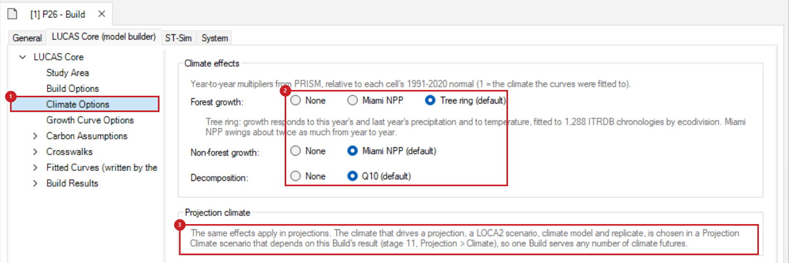

*Figure 3.5. Climate Options.*

### 3.5 Growth Curve Options

1. Choose **Growth Curve Options**.
2. **Fit new curves** (default): stage 2 fits merchantable volume and live-tree carbon curves to FIA for every ecodivision and forest type in CONUS, about 13 minutes. One fit can serve many Builds. P26 fits its own.
3. **Copy from another library**: reuse the curves of a library fitted with the same forest type classes. Set **Source library** (Browse...) and, optionally, the **Result scenario Id** (blank = the newest result in that library with curves). Takes seconds; remove stage 2 from the pipeline.
4. **FIA data**: where the FIA plot conditions come from. **USGS condition tables** reads the two summary tables (FIA Carbon Summary and FIA Disturbance Summary in Data Sources); **FIA DataMart** derives the same fields from the raw FIA tables of all states (FIA CONUS in Data Sources), and reproduced the USGS curves within 1% in testing. Here FIA DataMart: it needs only FIA CONUS, which the dead wood calibration reads anyway (section 3.6). Leave **Down dead carbon** at *Adjusted to field measurements by state*, and the fitting settings at their defaults.

The **Fitting settings** apply only when fitting; leave them at their defaults.

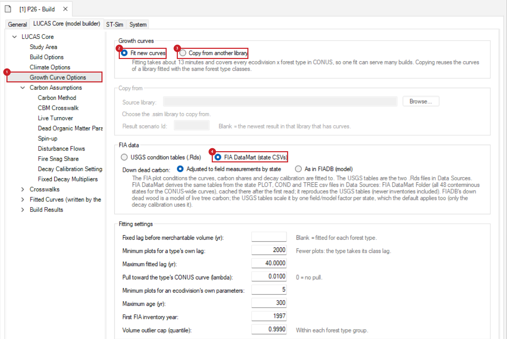

*Figure 3.6. Growth Curve Options.*

#### 3.5.1 Growth curves as a scenario of their own

The growth curves do not depend on the study area: stage 2 fits them for every ecodivision and forest type in CONUS. So they can be fitted once, in a scenario that runs stage 2 alone, and every Build in the library can use that result instead of fitting its own. This saves about 13 minutes per Build and guarantees that all Builds use identical curves.

**Make and run the Growth Curves scenario (once per library):**

1. Right-click the **Definitions** project and choose **New > Scenario**. Name it `Growth Curves` and describe it, for example: `FIA growth and live-tree carbon curves for CONUS (stage 2 alone), shared by every Build in this library.`
2. On its **General > Pipeline** page, add one stage: **2 - Fit Growth Curves**. Leave Dependencies empty.
3. On **LUCAS Core (model builder) > LUCAS Core > Growth Curve Options**, keep **Fit new curves** and the fitting settings (or change them: they apply to every Build that uses this result).
4. Run it (right-click > **Run**). Write down its **Result Id**.

**Use it in a Build:**

5. In the Build's **General > Dependencies** page, add the Growth Curves result.
6. On the Build's **General > Pipeline** page, remove **2 - Fit Growth Curves**. The pipeline becomes stages 0, 1, 5, 3, 4, 6, 7, 8; stage 3 reads the curves from the dependency.

A Build can get its growth curves three ways:

| Way | When to use it | Pipeline |
| --- | --- | --- |
| A Growth Curves scenario in the library (this section) | Several Builds in one library | Build without stage 2, depending on the Growth Curves result |
| Copy from another library (Growth Curve Options) | Curves fitted elsewhere, with the same forest type classes | Build without stage 2 |
| Fit in the Build (default) | A single Build | Build with stage 2 |

> Refit the Growth Curves scenario only when its inputs change (a new FIA release, or different fitting settings). Rerun the Builds that depend on it afterwards.

### 3.6 Carbon Assumptions

The carbon assumptions are the rates and settings stages 3 and 4 use: how each live pool turns over, how fast each dead pool decays, where high-severity fire and clearcut move carbon, and how the decay calibration is fitted. They are on the Build's **Carbon Assumptions** pages. The first page, **Carbon Method**, picks the method and fills the others with its rows.

1. Under **Carbon Assumptions**, choose **Carbon Method** (1).
2. **Dead organic matter** (2). **FIA measured dead wood** (default) calibrates the decay of snags, down logs, fine woody debris, litter and duff to FIA's measured dead wood in mature stands; snag fall comes from remeasured dead trees, and the fire and clearcut flows are fitted to FIA plots after those events. It needs FIA CONUS in Data Sources. **CBM defaults** uses the CBM-CFS3 default decay and snag fall rates with the LUCAS fire and clearcut flows, as the CONUS 1 km model did. Here FIA measured dead wood.
3. **Soil organic carbon** (3). **gSSURGO** calibrates soil decay so the spin-up's soil carbon matches each ecodivision and forest type's mean gSSURGO soil organic carbon; **CBM defaults** leaves soil carbon to the spin-up. Here gSSURGO.
4. Click **Fill with the FIA measured dead wood rows** (4). Until you do, the line beside the button says the sheets are empty: a run would still use the method's rows, but you could not see or edit them.

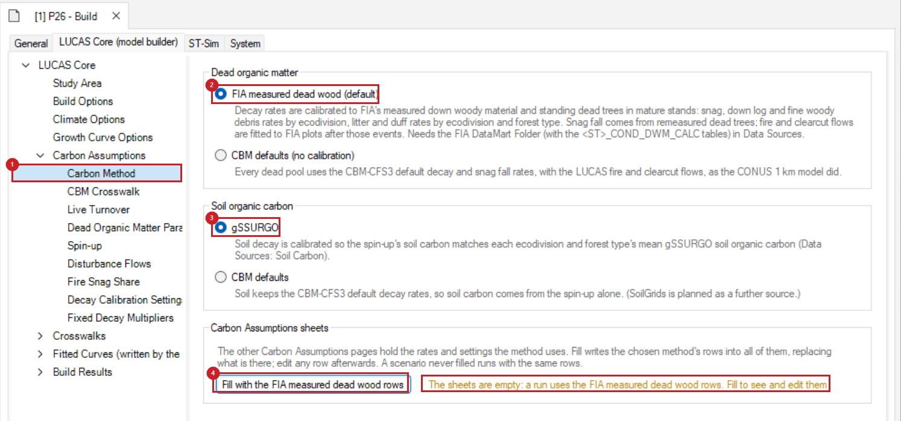

*Figure 3.7. The Carbon Method page of a new Build.*

5. Studio asks before replacing the rows of the eight pages. Click **OK** (5).

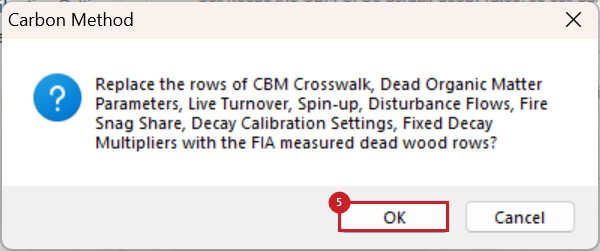

*Figure 3.8. Fill replaces the rows of every Carbon Assumptions page.*

6. The line now reads **Filled with the FIA measured dead wood rows** (6).

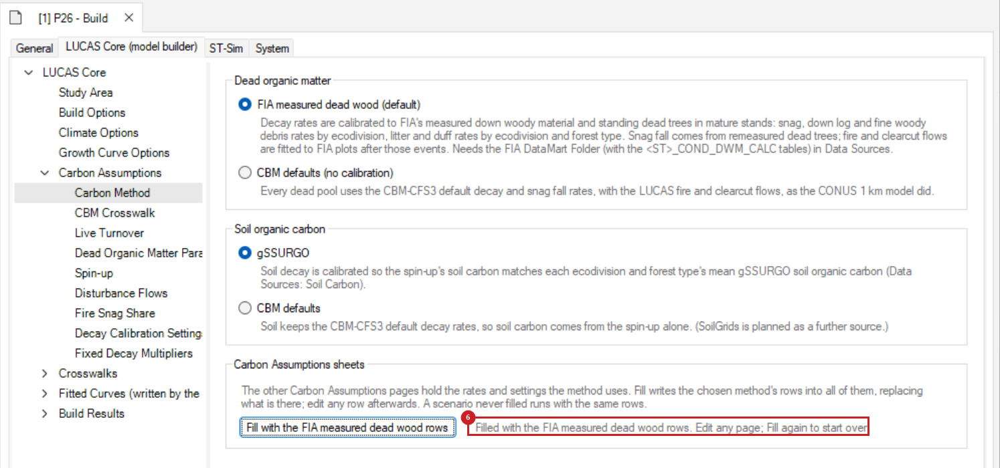

*Figure 3.9. The pages are filled.*

The other seven pages now hold the method's rows; edit any of them, or press Fill again to start over. On every page a row for one ecodivision overrides the forest type's all-ecodivisions row.

| Page | What it holds | Filled with (FIA measured dead wood) |
| --- | --- | --- |
| CBM Crosswalk | The CBM-CFS3 ecozone and species type each forest type takes its live turnover and snag rates from | The package crosswalk, 28 forest types |
| Live Turnover | Turnover rates and splits of the live pools, in place of the CBM ones | Empty: CBM rates |
| Dead Organic Matter Parameters | Base decay rate, reference temperature, Q10 and share emitted of each dead pool | CBM-CFS3 values, 9 pools |
| Spin-up | Return interval, share of past cycles ended by clearcut, last disturbance outside fire perimeters | Empty: LANDFIRE intervals, all high-severity fire, clearcut |
| Disturbance Flows | Where high-severity fire and clearcut move each pool's carbon | 39 flows fitted to FIA |
| Fire Snag Share | The share of live wood high-severity fire leaves standing, per forest type | 4 forest types fitted to FIA |
| Decay Calibration Settings | Mature age, years without fire or cutting, minimum plots and snags, multiplier ranges | 60, 30, 30, 200, 200, 0.05-20, 0.02-50 |
| Fixed Decay Multipliers | Decay multipliers you set instead of calibrating | Empty: every pool calibrated |

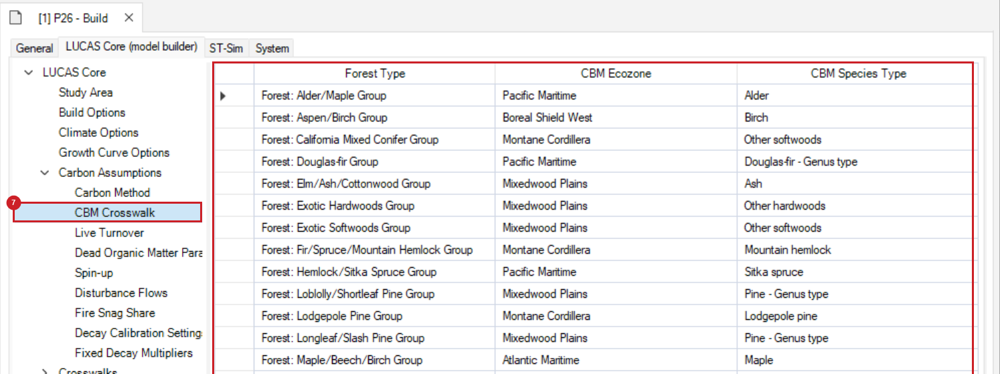

*Figure 3.10. CBM Crosswalk, one of the filled pages.*


*Figure 3.11. Decay Calibration Settings, written out at their defaults.*

> **Changing the method later.** Pick the other method and press **Fill** again: the eight pages then hold that method's rows. Changing the method without pressing Fill keeps the rows that are there, so a run would mix, for example, CBM default decay with the fitted fire flows.

> **Sharing one set of assumptions (advanced).** The Carbon Assumptions pages appear on every scenario. To share one set among several Builds, fill them on a scenario of their own and add that scenario as a dependency of each Build, leaving the Builds' own Carbon Assumptions pages empty: a Build's own rows win over a dependency's.

### 3.7 Land Cover Crosswalks

The crosswalks tell stage 5 which state class each land cover code becomes: forest types (state classes 100-999) from LANDFIRE EVT or the USFS forest type groups, grassland and shrubland types from RCMAP, wetland types from C-CAP.

1. Choose **Crosswalks > Land Cover Crosswalks**.
2. The table opens filled in with the package's crosswalks, one row per source code (about 1,350 rows). Leave them as they are, or change a **State Class** to send a code somewhere else; stage 5 logs every row that differs from the package default. A blank State Class marks a code with no LUCAS state class, not used by stage 5 (the Note says why).
3. **Reset to package defaults** puts every row back.

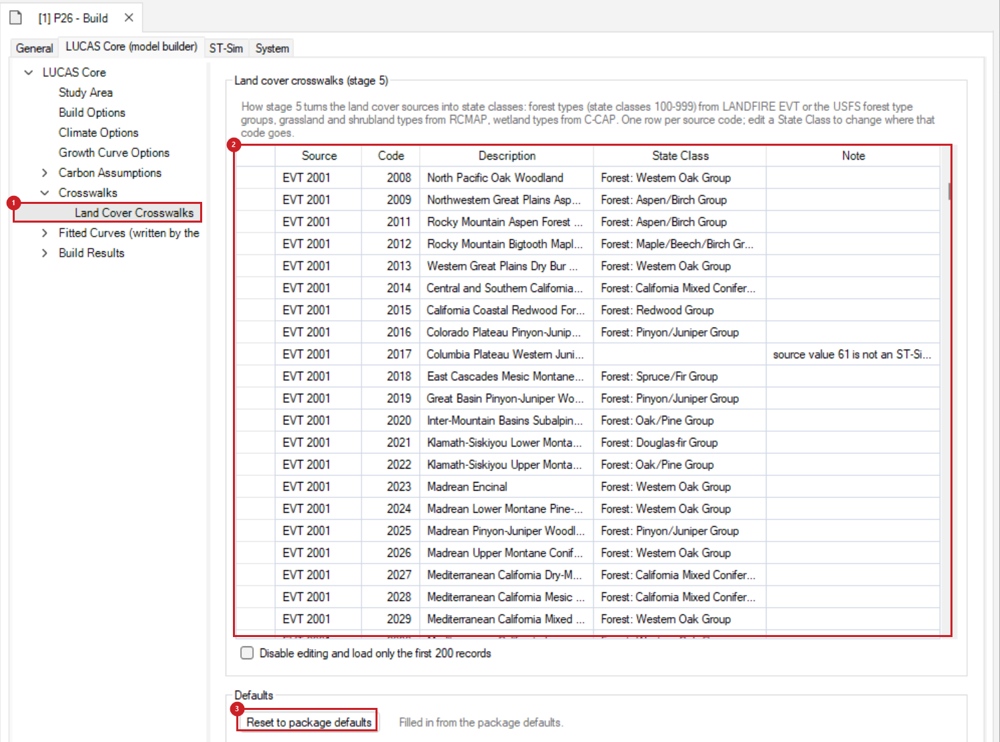

*Figure 3.12. Land Cover Crosswalks, filled in from the package defaults.*

Save the library (**File > Save**) before running.

## 4. Running the Build

Running the Build runs its pipeline, stages 0 to 8, one after another, and writes everything into a new **result scenario** under the Build. At 150 m a pyrome takes several hours; the library can stay open, but do not edit the Build while it runs.

### 4.1 Start the run

Save the library first (**File > Save**, or the save button on the toolbar). Then either:

1. Right-click the Build scenario in the Explorer.
2. Choose **Run**.

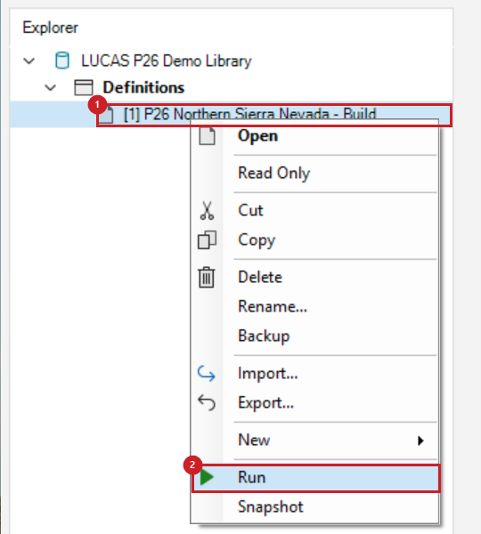

*Figure 4.1. Run from the scenario's menu.*

or

3. Select the Build scenario and click **Run Scenario**, the green triangle on the toolbar.

![The toolbar with the Run Scenario button marked 3 and the Build scenario \[1\] P26 - Build selected in the Explorer](images/fig-4.2.png)

*Figure 4.2. Run from the toolbar.*

### 4.2 While it runs

Studio opens the **Run Monitor** tab when a run starts.

1. **Run Monitor** lists each run in progress.
2. **Result Id** is the number the result scenario will have (here 2), and **Status** reads Running. Write the Result Id down: the historical run and the Projection Setup depend on this result.
3. The red square stops the run. A stopped Build leaves an incomplete result; delete it and run again.
4. **Run Log** stays grey while the model runs; the log opens once the run ends (section 4.2).

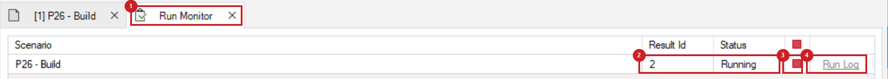

*Figure 4.3. The Run Monitor during the Build.*

5. The status bar at the bottom of the window shows a progress bar and the stage running now, for example "1 - Study Area and Strata". The run log (section 4.2) gives the time each stage took.

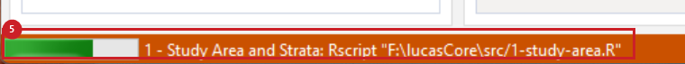

*Figure 4.4. The stage running now.*

> Keep the library open but leave the Build alone while it runs: SyncroSim runs the stages from the package folder and writes into the library as each stage ends.

### 4.2 The run log

When the run ends, the Run Monitor shows **Done** and its **Run Log** link opens the log (Figure 4.5). Each stage writes what it read, the choices it made, its checks (a line that starts with the stage number and ends in *pass* or *fail*, with the numbers behind it) and the time it took. The end of the log gives the study area's initial carbon from stage 8 (6) and the total run time (7).

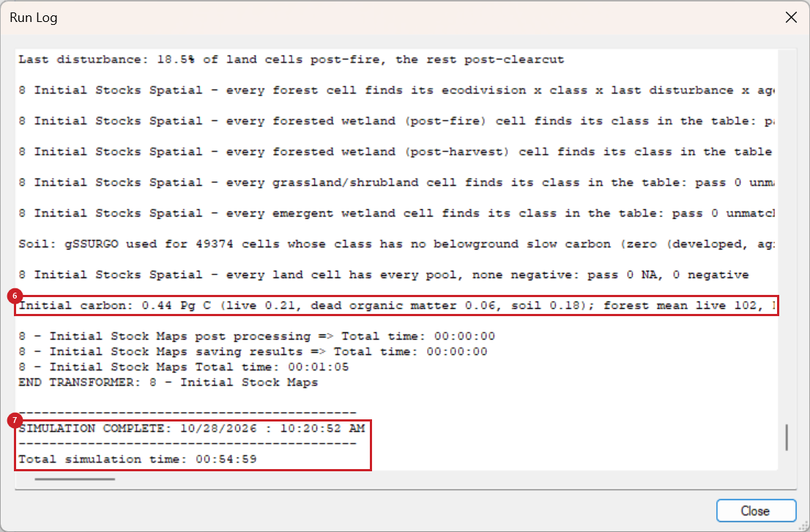

*Figure 4.5. The end of the P26 Build's run log.*

The P26 Build took 55 minutes on a 32-core machine. Stage 5 and stage 2 take most of it:

| Stage (pipeline order) | Time (min:s) | Where the time goes |
| --- | --- | --- |
| 0 Stock-Flow Definitions | 0:40 | the stock and flow definitions |
| 1 Study Area and Strata | 3:01 | the study area and strata rasters |
| 5 Initial Conditions | 22:28 | area-matched land cover for 39 years (11.6 min), forest type and age maps |
| 2 Fit Growth Curves | 13:20 | growth curves for 28 forest type groups (9.2 min), live carbon (2.7 min) |
| 3 Carbon Flows | 3:01 | flow pathways and the decay calibration (0.8 min) |
| 4 Spin-up and Initial Stocks | 0:38 | carbon by age for each ecodivision and forest type |
| 6 Historical Transitions | 6:29 | 30 m disturbance maps and land-use change, 1986-2023 |
| 7 Climate Multipliers | 4:12 | PRISM growth and decay multipliers, 1985-2023 |
| 8 Initial Stock Maps | 1:05 | the 1985 carbon maps |
| **Total** | **54:59** |  |

### 4.3 Checking the result

The finished run adds a result scenario under the Build in the Explorer, here **\[2\] P26 - Build (\[1\] @ 28-Oct-2026 9:25 AM)**. Everything the stages wrote is in it, and the next steps (Build Figures, the historical run) depend on this result, not on the Build itself.

![The Explorer with the result scenario \[2\] P26 - Build under the Build's Results folder marked 8, its General Summary page with the Build's description, and the Run Log button marked 9](images/fig-4.6.png)

*Figure 4.6. The result scenario (8) under the Build's Results folder. Its Summary page keeps the Build's description, and Run Log (9) opens the log again at any time.*

**Validation.** Every check a stage runs goes to the result's **LUCAS Core > Build Results > Validation** page, one row per check with its stage, status and detail. The P26 Build ran 68 checks and all passed. A failed check says what went wrong in its detail; the same line is in the run log.

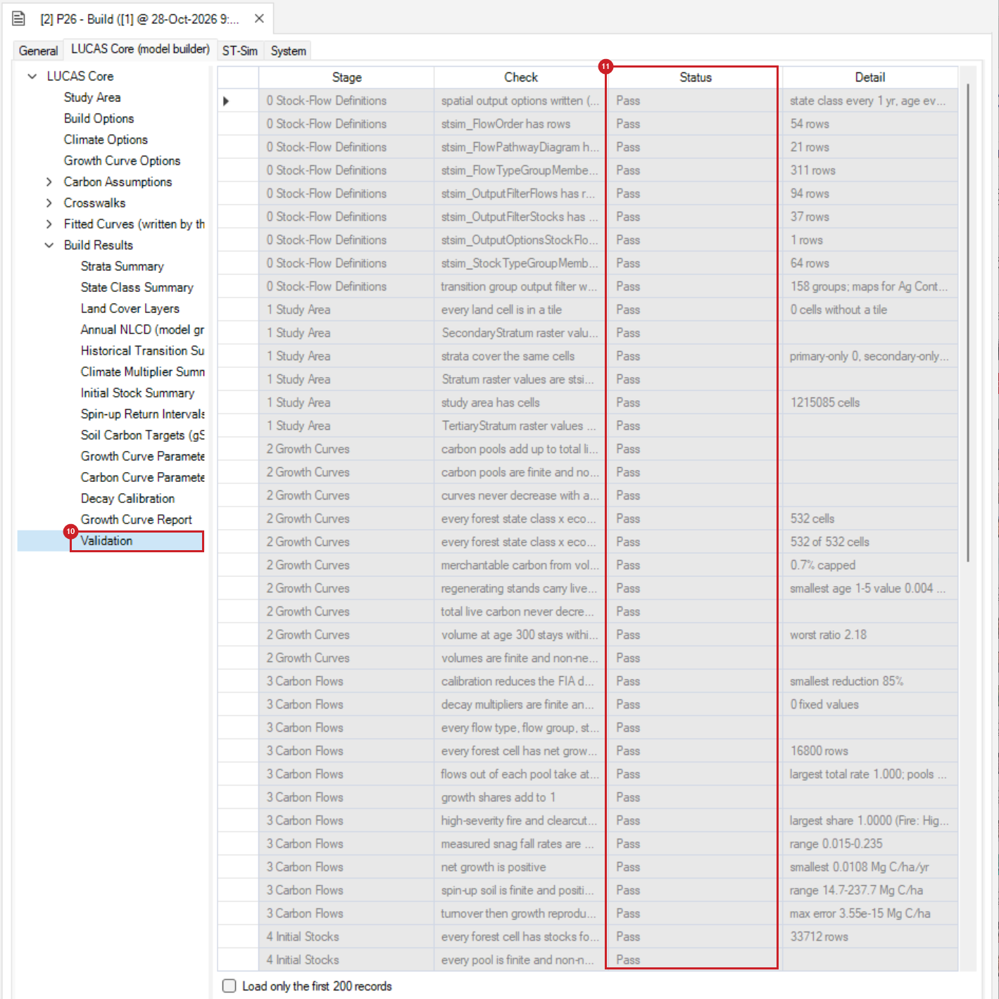

*Figure 4.7. The Validation page (10) of the P26 Build result: every check passes (11). Hover over a cut-off Check or Detail to read it whole, or widen the column.*

**Numbers worth a look.** Each stage's summary lines in the run log are the quickest check that the Build did what you meant. For P26:

- **Land cover (stage 5, section 3.3.1).** Area in the wrong class 28 km² in 1985 and 65 km² in 2023, a mean of 47 km² (Modal: 1,078 km²). Developed land grows from 876 to 1,121 km², against 876 to 1,108 km² in the 30 m NLCD; 184 km² of cells flip between classes.
- **Forest (stage 5).** 883,048 forest cells, 72.7% of the land; spin-up return intervals (LANDFIRE replacement-severity fire) of 140 to 311 years, median 186.
- **Growth curves (stage 2).** 532 curves (28 forest types x 19 ecodivisions), of which the study area's two ecodivisions use 56.
- **Carbon (stage 3).** The decay calibration cut the misfit to FIA measured dead wood by 94% (median of the 56 cells), and the spin-up's soil carbon matches gSSURGO (62 against 62 Mg C/ha).
- **Initial carbon (stage 8).** 0.44 Pg C: live 0.21, dead organic matter 0.06, soil 0.18. Forest means 102, 24 and 69 Mg C/ha.

**Initial Stock Summary.** **Build Results > Initial Stock Summary** (12) gives the 1985 carbon by state class: its cells, the share whose last disturbance was a fire, mean live, dead organic matter and soil carbon (Mg C/ha), total carbon (Tg C, 13) and where the stocks came from (the stock curves for forest, fixed values for grassland and shrubland, gSSURGO for wetlands). In P26, California Mixed Conifer holds 245 of the 440 Tg C.

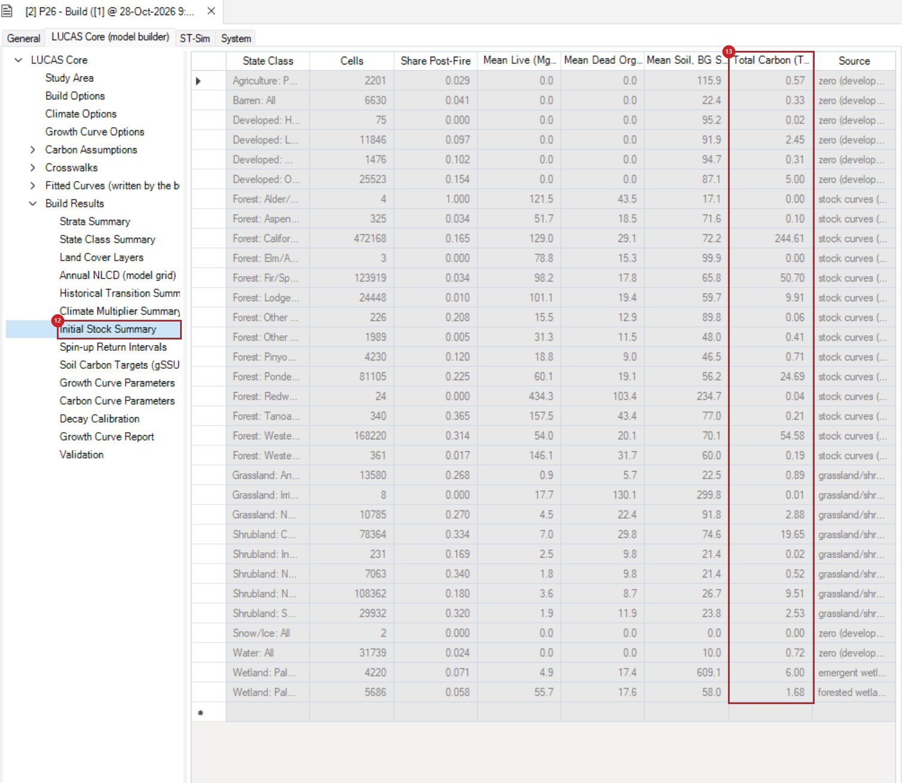

*Figure 4.8. The Initial Stock Summary of the P26 Build: carbon in 1985 by state class.*

### 4.4 Build Figures: maps and charts of the Build

Stage 12 draws report figures of a finished Build in the format of the lucasFireC2F report: each figure is one PNG headed *Figure N* with a note naming the study area, grid and years, and its panels are lettered (a), (b), (c). The **maps** sit on shaded relief from the elevation file in Data Sources, which runs on in light grey past the study area. Inside it the classes are blended into the relief, with a colour strip or a key under each panel. Panels stand side by side, or one under another when the study area is wide. The ten figures are the study area and strata, the initial land cover (state class, forest type, stand age) and the initial carbon (total, live biomass, soil), then **charts** of area and carbon by state class, the growth curves, the decay calibration, historical land-use change, disturbance, the climate multipliers and the Build's checks. Each comes with a caption ready for a report. Stage 12 reads only the Build's outputs, so it can run in a scenario of its own on the Build result, and takes a few minutes.

A Build whose pipeline does not include stage 12, such as this P26 Build, draws its figures in a scenario of its own on the Build result. A folder keeps such scenarios apart from the Builds and runs.

1. Right-click the Build result (or the **Definitions** project) and choose **New > Folder** (1). Name it `Figures`; it appears under **Definitions**.

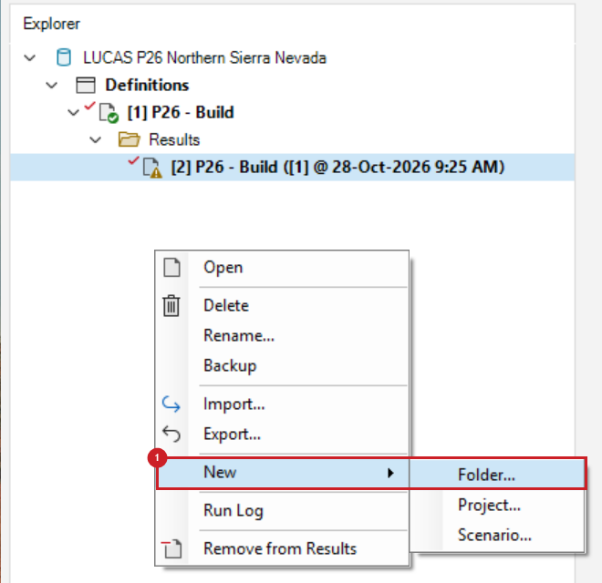

*Figure 4.9. A new folder for the figure scenarios.*

2. Right-click the **Figures** folder, choose **New > Scenario** (2) and name it `Build Figures`.

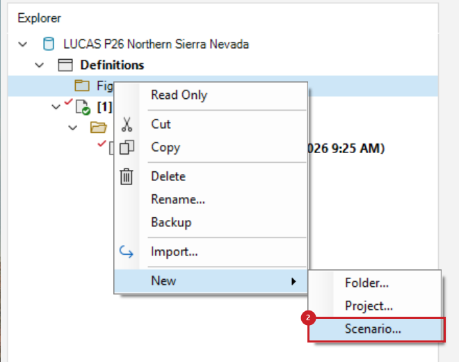

*Figure 4.10. A new scenario in the Figures folder.*

3. Add the Build result as its dependency: drag the result, `[2] P26 - Build (...)`, from the Build's **Results** folder onto the new scenario. It appears under the scenario's **Dependencies** folder (3).

![The Explorer with the Figures folder, the \[3\] Build Figures scenario and its Dependencies folder holding the P26 Build result, marked 3](images/fig-4.11.png)

*Figure 4.11. The Build Figures scenario in its folder, with the Build result as its dependency.*

4. Double-click the scenario and open **General > Pipeline** (4). It lists the Build's nine stages in grey (5), because a dependency supplies its pipeline too: the box **Inherit values from '\[2\] P26 - Build ...'** (6) is ticked.

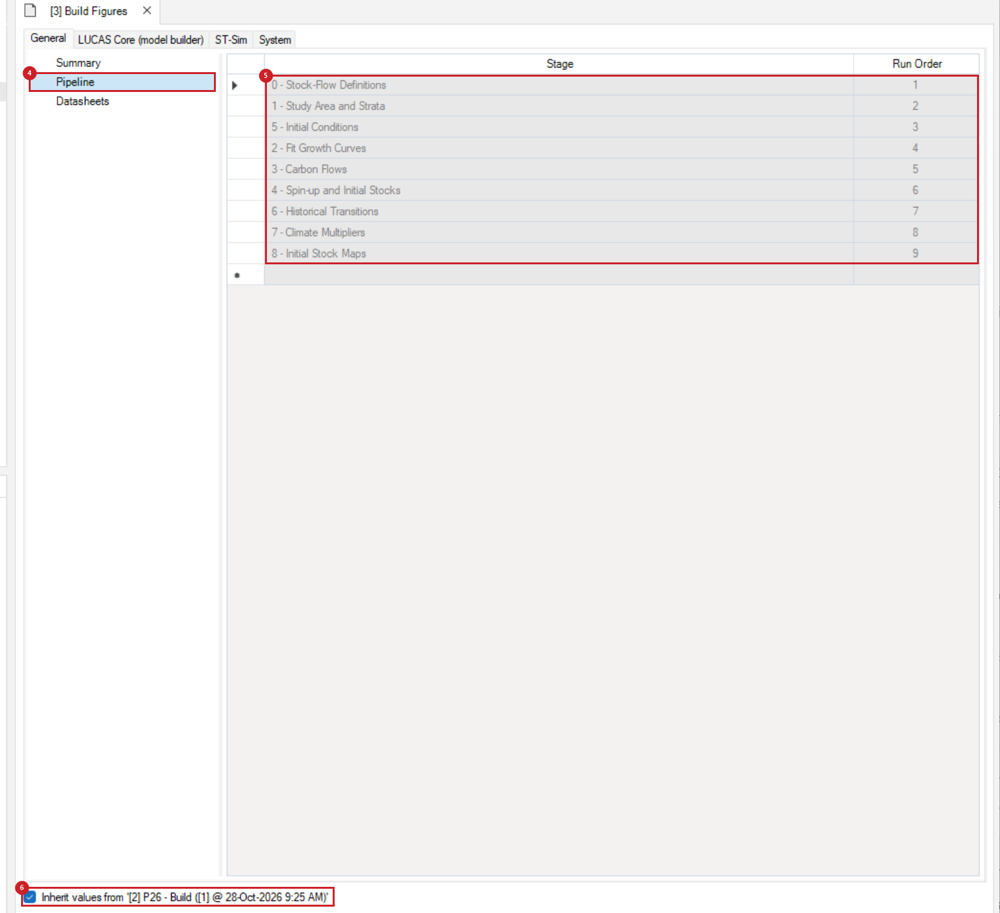

*Figure 4.12. The pipeline inherited from the Build result.*

5. Untick **Inherit values** (6). Studio asks what to do with the inherited rows: choose **No Data** (7), which leaves the pipeline empty.


*Figure 4.13. No Data starts the pipeline empty.*

> Leave the box ticked and this scenario reruns the whole Build. **Copy Data** copies the nine Build stages into the scenario, and you would then have to delete them.

6. In the empty row, choose **12 - Build Figures** as the **Stage**, with **Run Order** 1 (8). Save the library (**File > Save**).

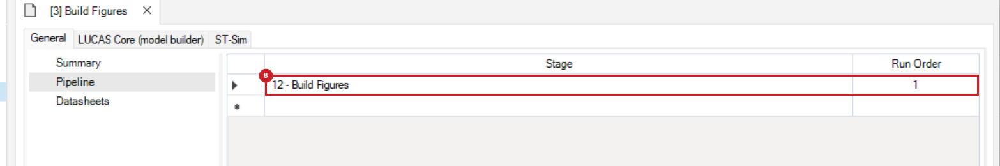

*Figure 4.14. The Build Figures pipeline: stage 12 alone.*

7. Run the scenario as in section 4.1. The result appears in the scenario's **Results** folder, and its run log lists the figures drawn.

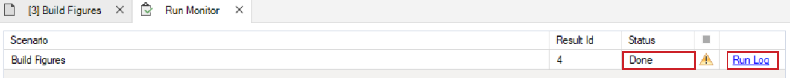

*Figure 4.15. The finished Build Figures run in the Run Monitor. For P26 it took a minute and a half. The warning icon is the package-version note every run shows.*

**Where the figures are.** Double-click the result scenario and open **LUCAS Core > Build Results > Build Figures (PNG)**. The page is a figure viewer: pick a figure from its drop-down or step through them, with each caption below (section 9.1). The files are in the library's data folder, under `<library>.ssim.data\Scenario-<result id>\lucasCore_OutputBuildFigure`.

**Export them all to a folder.**

8. Select the result scenario in the Explorer. In the panel below the Explorer, open the **Export** tab (9), select **LUCAS Core > Build Figures (PNG)** (10) and click **Open** (11), then choose the folder to copy the PNGs into.

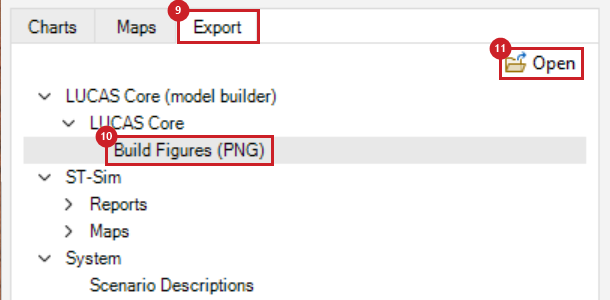

*Figure 4.16. Exporting every Build figure to a folder.*

> Each figure is drawn only when its inputs exist. A Build without stage 6 has no land-use change or disturbance charts. Without an elevation file the maps have no relief. A strata level with a single unit, such as one state, is not mapped.

The export names each file after its result scenario, for example `scn4.Fig02_land_cover.png`, so figures exported from several Builds can share a folder.

**Examples from the P26 Build.** Four of the ten figures stage 12 draws for P26 Northern Sierra Nevada (27,339 km² at 150 m, 1985 to 2023):

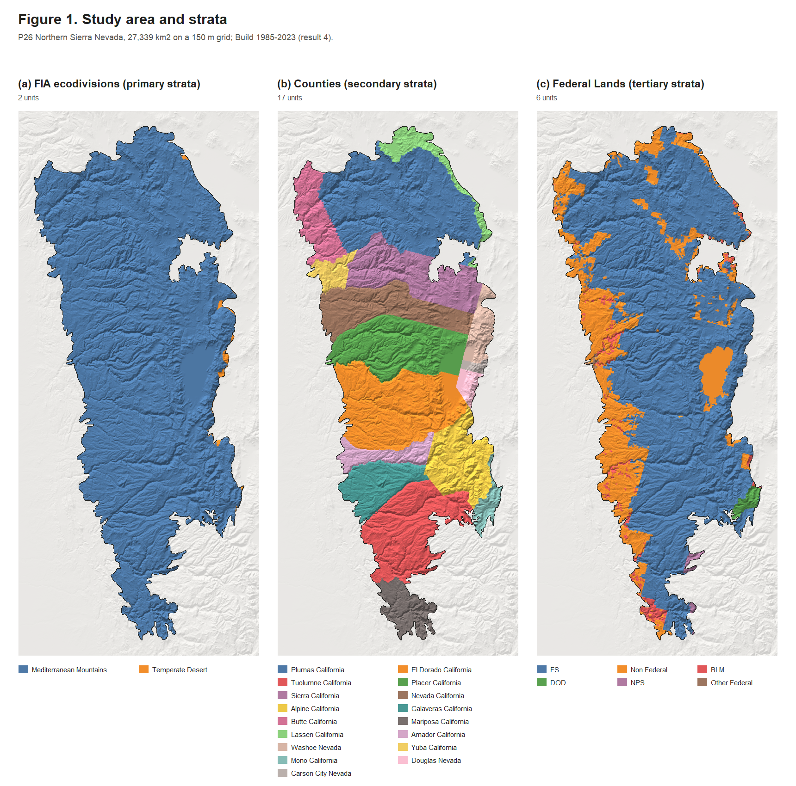

*Figure 4.17. Study area and strata: (a) FIA ecodivisions, (b) the 17 counties, each in its own colour, and (c) federal lands.*


*Figure 4.18. Initial land cover in 1985: (a) state class, the twelve largest named, (b) forest type group and (c) stand age of the forest cells. Grey inside the study area: not forest.*

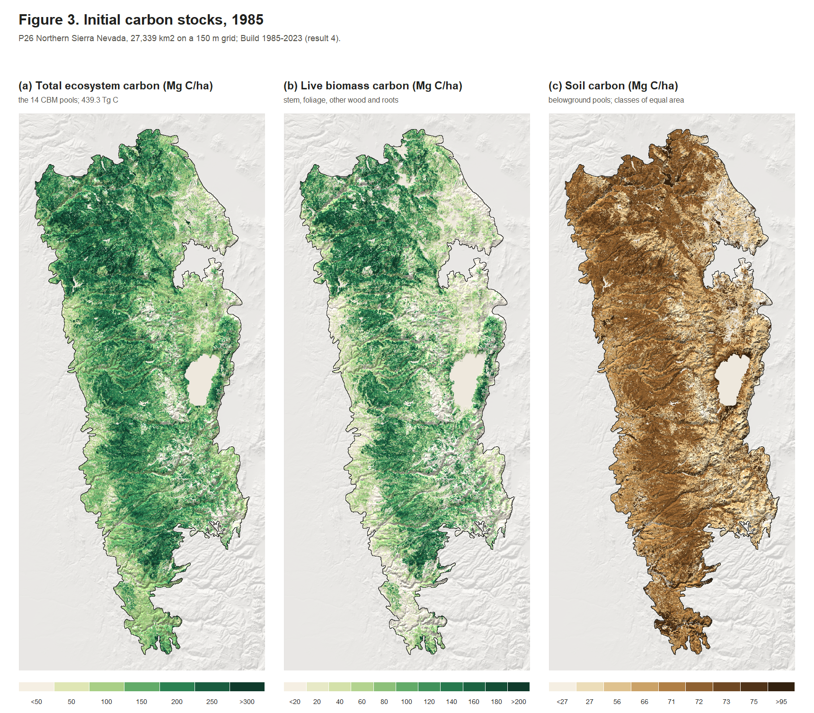

*Figure 4.19. Initial carbon stocks in 1985: (a) total ecosystem carbon, 439 Tg C in the study area, (b) live biomass and (c) soil carbon. (a) and (b) are classed in even steps; (c) in classes of roughly equal area, because forest soil starts at its forest type's gSSURGO mean and so bunches between 66 and 75 Mg C/ha.*

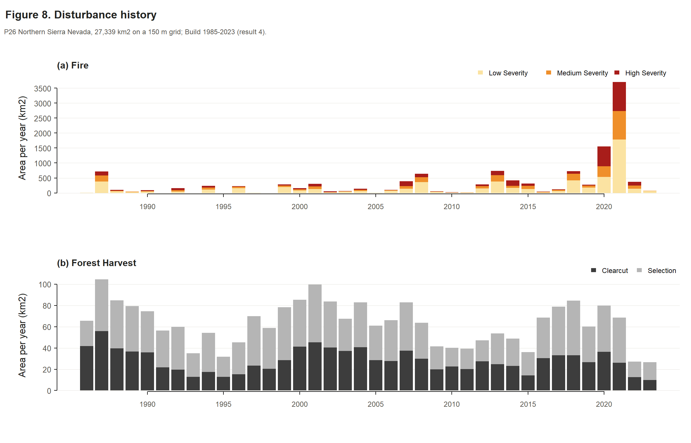

*Figure 4.20. Disturbance history, 1986 to 2023: (a) area burned each year by MTBS severity class and (b) area harvested each year by clearcut and selection (LCMS tree removal).*

## 5. The historical run

The historical run is an ordinary ST-Sim scenario. It simulates the study area from the Build's start year to its end year (1985 to 2023 for P26) with the transitions, growth curves and carbon flows the Build prepared. Its result is the land-use and carbon history of the study area, and the starting point for projections. No lucasCore stage runs here: the Build result already holds the initial conditions, transitions, flows, multipliers and initial stocks, and the stock-flow definitions written by stage 0. So the scenario needs only three things: a dependency on the Build result, ST-Sim as its pipeline, and the run settings on its ST-Sim tab.

### 5.1 Create the scenario

1. Right-click the Build (or the **Definitions** project), choose **New > Scenario** (1), name it, for example, `P26 - Historical`, and click **OK**.

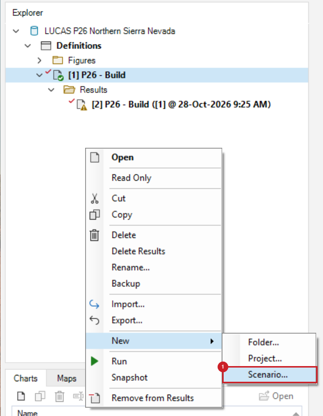

*Figure 5.1. A new scenario for the historical run.*

2. Add the Build result as its dependency: drag it from the Build's Results folder onto the new scenario, as in section 4.4. The new scenario (2) shows the Build result under **Dependencies** (3).

![The Explorer with the \[5\] P26 - Historical scenario marked 2 and its dependency on the P26 Build result marked 3](images/fig-5.2.png)

*Figure 5.2. The historical run and its dependency on the Build result.*

3. Double-click the scenario and open **General > Pipeline**. As in section 4.4, it first inherits the Build's nine stages: untick **Inherit values** and choose **No Data** (Figures 4.12 and 4.13).
4. In the empty row, choose **ST-Sim** as the **Stage** (4), with **Run Order** 1 (5).

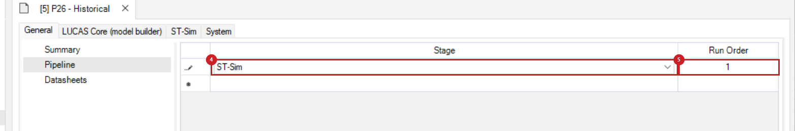

*Figure 5.3. The historical run's pipeline: ST-Sim alone.*

> A library made before stage 0 existed keeps its stock-flow definitions in a separate **Stock-Flow Definitions** scenario. There, add that scenario as a second dependency, below the Build result.

### 5.2 Run Control and outputs

The Build result supplies the model and, through stage 0, the map and carbon output settings, which this scenario inherits. It has no Run Control and no yearly state class or transition tables, because the Build stages never run ST-Sim. Set those on this scenario's own **ST-Sim** tab.

5. Open the **ST-Sim** tab (6) and **Run Control** (7). Enter the Build's years and one iteration (8): **Start years** `1985`, **End years** `2023`, **Total iterations** `1`. Tick **Run model spatially** (9).

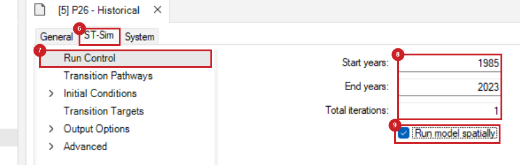

*Figure 5.4. Run Control for the P26 historical run.*

> The start year is the initial state the Build mapped, so the first transitions happen in 1986. Transitions are random wherever a multiplier covers only part of a cell, so more iterations give a range of outcomes, at proportionally more run time and disk space. One iteration is enough to check the run.

6. Open **Output Options > Tabular** (10). Tick **State classes every** `1` years (11) and **Transitions every** `1` years (12). These yearly tables, by stratum, are what the results charts use.

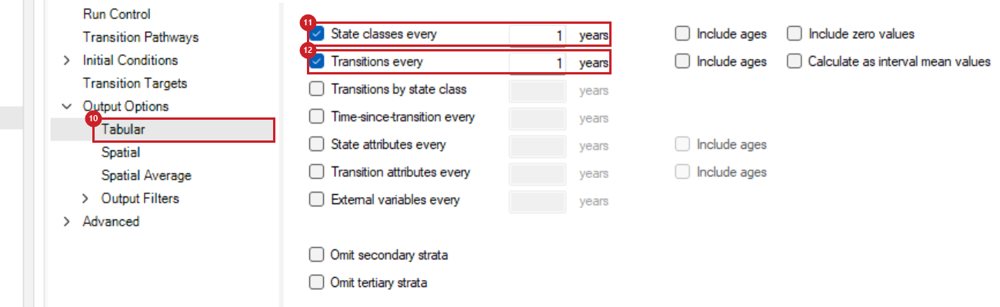

*Figure 5.5. Yearly state class and transition tables.*

7. Open **Output Options > Spatial** (13). The Build result supplies the maps, so the page is greyed and its **Inherit values** box is ticked: **State classes** and **Ages every** `1` years (14), and **Transitions every** `1` years (15). That is a state class map, an age map and a map of each transition group for every year, which Studio's **Maps** tab can show and animate.

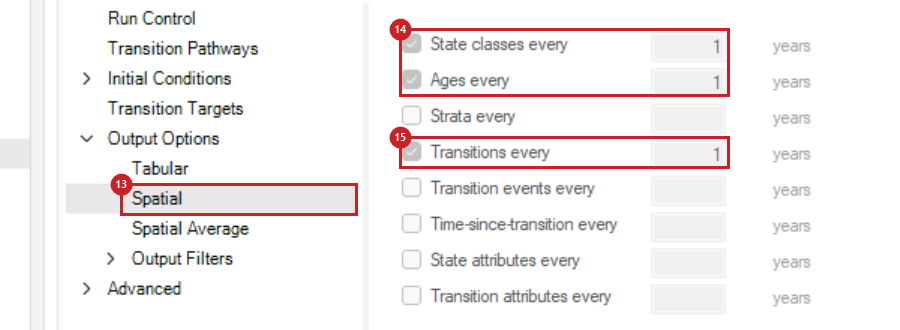

*Figure 5.6. Yearly state class, age and transition maps.*

> **Keep the age maps on.** A projection starts from the historical run's final state class, age and stock maps (the Projection Setup's hand-over, chapter 6), so a run without an age map for its last year cannot be projected from. Builds run from 25 October 2026 write these three map settings as defaults (stage 0), and the page shows them inherited. If you untick **Inherit values** to change the page, keep **Ages** ticked.

> Each yearly map of P26 has 1.2 million cells, so even with the filter below, maps every 5 or 10 years are enough to see the pattern of change; the yearly tables of step 6 still give every year. **Ages every** adds a stand age map, useful for checking how disturbance resets age.

The transition maps are limited by the **transition group output filter**, under **Output Options > Output Filters > Transition Groups** (16). Without it, ST-Sim writes a map for every group: the 15 named groups and an automatic *\[Type\]* group for each of the \~140 transition types. The Build writes the filter, and every run on the Build result inherits it. It lists every group with its yearly **Summary** on, but turns on **Spatial** (maps) and **Spatial Probability** (average probability maps) only for the main families: Urbanization, Intensification, Ag Expansion, Ag Contraction (17), Fire, Forest Harvest and Insect, plus the two harvest type groups, *Forest Harvest: Forest Clearcut \[Type\]* and *Forest Harvest: Forest Selection \[Type\]*. ST-Sim writes maps per **transition simulation group** (the Definitions project's ST-Sim tab, **Transition Simulation Groups**). A transition type that no simulation group covers is simulated, and mapped, on its own, so a family's Spatial setting has no effect unless the family is a simulation group. Urbanization and Fire are; clearcut and selection are simulated as separate types, so that projections can target them separately, and their type groups carry the maps. Each map records which type happened in each cell (the severity class of a fire, the intensity of new development). To map another group, set its **Spatial** to Yes here, on the group ST-Sim simulates.


*Figure 5.7. The transition group output filter: maps only for the main families.*

> A Build run before the filter was added (October 2026) has none, and its runs map every group. Rerun the Build's stage 0, or fill this page by hand.

8. Check the carbon outputs under **Advanced > Stocks and Flows > Output Options > Tabular and Spatial** (18). They come from the Build result, which stage 0 filled, so the page is greyed and its **Inherit values** box is ticked. They are yearly stock and flow tables, plus average stock and flow maps every year (19).

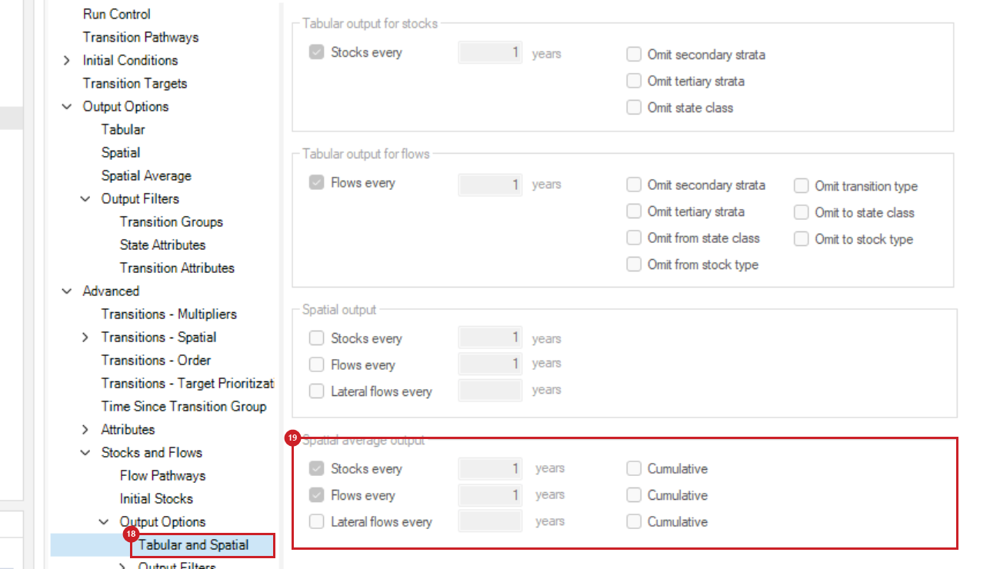

*Figure 5.8. Stock and flow outputs inherited from the Build result.*

> Yearly flow maps at fine resolution are large: every flow group, every year. To write maps only in the first and last year, untick **Inherit values** on this page and choose **Copy Data**, which keeps the inherited settings to edit. Then set the spatial average **Stocks every** `38` years (1985 and 2023) and untick **Flows every**. The yearly tables are unaffected.

The stock and flow maps are limited the same way, by **Stocks and Flows > Output Options > Output Filters > Stocks** and **Flows**, which the Build also writes. Every stock and flow group keeps its yearly **Summary**, but maps (**Spatial** and **Average Spatial**) are on only for the carbon pools (biomass, dead organic matter, soil and total ecosystem carbon) and the main fluxes (emissions, harvest, mortality and net primary, ecosystem and biome productivity). To map another group, set it to Yes on these pages.

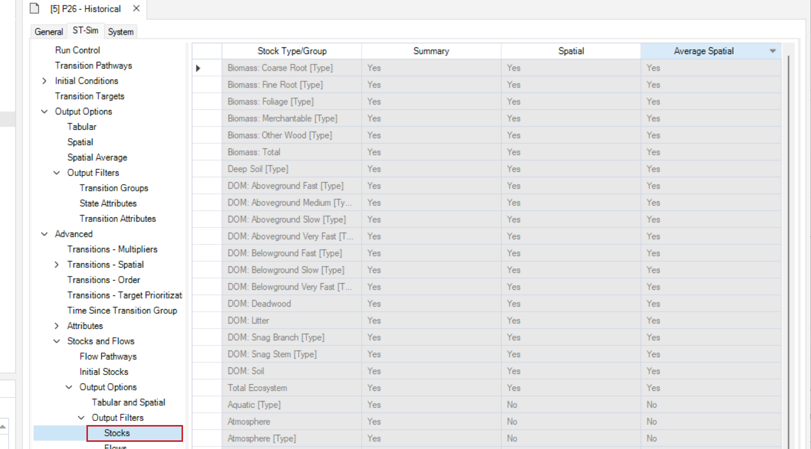

*Figure 5.9. The stock output filter: maps for the carbon pools only.*

### 5.3 Spatial multiprocessing (optional)

A spatial run can be split into tiles that run at the same time, one job per tile, and the results are joined when they finish. Two settings do it: a tiling raster, which the Build result supplies, and multiprocessing turned on for the library.

> ST-Sim's **Advanced > Secondary Stratum Multiprocessing** (*Split by Secondary Strata*) splits only non-spatial runs. A spatial run like this one is split only by the tiling raster.

9. Check the tiling raster. Stage 1 writes `Build-Tiles.tif`, the tiles chosen in Build Options (section 3.3): for P26, 5 tiles of whole counties, each holding about a fifth of the study area's cells. On the scenario's **System** tab (20), **Spatial Multiprocessing** (21) shows it inherited from the Build result (22). To tile differently, untick **Inherit values** and **Browse** to another raster, for example the Build result's `SecondaryStrata.tif` for one tile per county, under `<library>.ssim.data\Scenario-<Build result id>\stsim_InitialConditionsSpatial`.

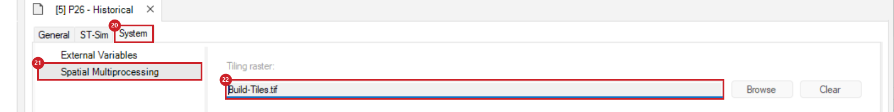

*Figure 5.10. The Build's tiles as the tiling raster.*

> A tile is a whole number of strata units, so any strata map works for the historical run: it has no transition targets, only the Build's spatial multipliers. Projections are different: a transition target's unit must not be split between tiles, so the tiles must follow the strata level the targets use (section 6). The run waits for its largest tile, and P26's counties range from Plumas to Alpine, so the gain is less than the number of tiles suggests.

*Table 5.1. P26's 17 county tiles, largest first: simulation cells at 150 m (0.0225 km² each), area, and share of the study area's 1,215,085 cells. Counted from the Build's `SecondaryStrata.tif`.*

| County | State | Cells | Area (km²) | Share of cells |
| --- | --- | --: | --: | --: |
| Plumas | CA | 240,304 | 5,407 | 19.8% |
| El Dorado | CA | 159,951 | 3,599 | 13.2% |
| Tuolumne | CA | 124,876 | 2,810 | 10.3% |
| Placer | CA | 121,383 | 2,731 | 10.0% |
| Sierra | CA | 101,623 | 2,287 | 8.4% |
| Nevada | CA | 91,734 | 2,064 | 7.5% |
| Alpine | CA | 79,472 | 1,788 | 6.5% |
| Calaveras | CA | 57,183 | 1,287 | 4.7% |
| Butte | CA | 53,219 | 1,197 | 4.4% |
| Mariposa | CA | 39,688 | 893 | 3.3% |
| Lassen | CA | 33,807 | 761 | 2.8% |
| Amador | CA | 32,151 | 723 | 2.6% |
| Washoe | NV | 27,410 | 617 | 2.3% |
| Yuba | CA | 19,637 | 442 | 1.6% |
| Mono | CA | 16,287 | 366 | 1.3% |
| Douglas | NV | 11,456 | 258 | 0.9% |
| Carson City | NV | 4,904 | 110 | 0.4% |
| **Total** |  | **1,215,085** | **27,339** | **100%** |

The tiles are very uneven: Plumas has 49 times the cells of Carson City, and the four largest counties hold over half the study area. A run cannot finish before its largest tile, so with county tiles P26 runs at best about five times faster than without tiles (100% / 19.8%), however many cores the computer has. Plumas also sets the memory: its job holds about a fifth of the whole study area's cells, while the five smallest tiles together hold less than a twentieth.

That is why stage 1 groups the counties into tiles of about equal size: P26's 5 Build tiles each hold about 20% of the cells, so 5 jobs finish together, as fast as 17 county tiles would, while loading each job's fixed memory (below) 5 times instead of 17.

10. Turn on multiprocessing for the library. Double-click the library in the Explorer (23), open **System > Multiprocessing > General** (24), tick **Enable multiprocessing** (25) and set **Maximum number of jobs** (26). More jobs than tiles leave the extra jobs idle; more jobs than processor cores slow the run. The **Multiprocessing** button on the toolbar is highlighted while it is on (27).

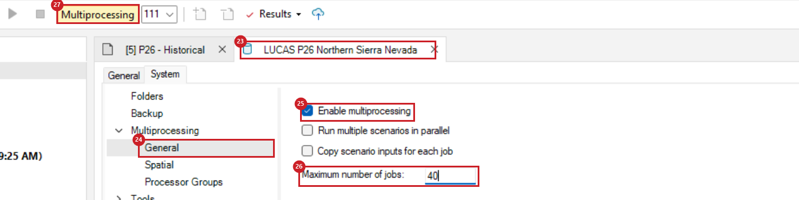

*Figure 5.11. Library multiprocessing turned on.*

> Section 1.4 turned library multiprocessing off for the Build. Turn it on for tiled ST-Sim runs, and off again before running a Build.

**Cores, tiles and memory.** Each job is a separate ST-Sim process that holds its tile's maps in memory: state class, age, strata, the transition multipliers, the 14 carbon pools and the maps being written. So a job's memory grows with the number of cells in its tile, and the run needs the memory of every job running at once. A computer can have enough cores for many jobs but not enough RAM to hold them all; jobs then page to disk or fail, and the run can be slower than with fewer jobs. Three things set the balance:

- **Model resolution.** Halving the cell size quadruples the cells, and with them each job's memory. P26 has 1.2 million cells at 150 m; at 30 m it would have about 30 million.
- **Tile size.** Smaller tiles need less memory per job, but only the largest tile sets the peak, and P26's largest counties hold many times the cells of its smallest.
- **Maximum number of jobs.** This is the number of tiles held in memory at once.

A job's memory has two parts: a fixed part that every job loads whatever its size (the project's definitions, strata lists, transition and flow tables), and a part that grows with its tile's cells. To choose the number of jobs, start a tiled run with a few jobs and watch the **SyncroSim.Console** processes in Task Manager (**Details** tab, one per job, with a **Peak working set** column you can add). Then set **Maximum number of jobs** so that the jobs' peaks together fit in the free RAM, leaving a few GB for Windows and Studio, and no more than the number of cores. If a run fills the RAM, lower the jobs or split the study area into more, smaller tiles; smaller tiles lower the part that grows with cells, but not the fixed part.

**P26 example.** The historical run at 150 m with the 17 county tiles, measured on 24 October 2026 while it ran:

|  | Peak memory per job |
| --- | --: |
| Largest job (a large county, \~20% of the cells) | 3.9 GB |
| Smallest job | 1.4 GB |
| Most jobs | 1.7 to 2.8 GB |
| **All 17 jobs, sum of peaks** | **38 GB** |
| All 17 jobs, in use at one moment mid-run | 25 GB |

Even the smallest county's job peaks at about 1.4 GB, so for P26 roughly 1.5 GB of each job is the fixed part; only the remaining 2.4 GB of the largest job comes from its cells. The jobs do not all peak at once, so the run needed about 25 GB at a time, but plan for the sum of peaks. On the 1 TB, 112-core server this run used, 17 jobs is far inside both limits. On a 32 GB workstation the same run should use at most about 6 jobs, and on 64 GB about 12. At 30 m, with 25 times the cells, the part that grows with cells would dominate: expect tens of GB for the largest county alone, and plan for fewer jobs or smaller tiles.

### 5.4 Run the historical run

11. Save the library (**File > Save**) and run the scenario as in section 4.1. Its result appears in the scenario's **Results** folder.

With spatial multiprocessing on, the Run Monitor lists one job per tile under the scenario (28): 5 jobs for P26's Build tiles, each with its own progress bar and the year it has reached.

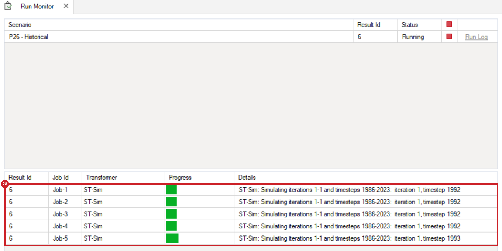

*Figure 5.12. The historical run split into 5 tile jobs.*

> The tiles hold about the same number of cells, so the jobs keep pace: all five were at 1992 or 1993 in Figure 5.12. With one tile per county they would not: a small county reaches 1995 while a large one is still at 1987. The scenario finishes when its slowest job does, and then merges the jobs' outputs into one result ("ST-Sim merging jobs" in the run log).

**The P26 run.** One iteration, 1985 to 2023 at 150 m, 17 county jobs, on the 112-core server (24 October 2026):

| Step in the run log | Time |
| --- | --: |
| ST-Sim creating jobs | 0:00:04 |
| ST-Sim running jobs | 2:43:03 |
| ST-Sim merging jobs | 0:07:55 |
| **Total** | **2:51:03** |

The five jobs each hold about a fifth of the cells (20.2% for the largest), so they ran side by side for the full 2 hours 43 minutes. Merging their tables and maps took another 8 minutes. The result holds the yearly state class, transition, stock and flow tables, a state class map for every year, a transition map for every year of each mapped family, and yearly average stock and flow maps: 2,207 files, 4.3 GB in the library's data folder, with the library file at 1.5 GB. Three earlier P26 runs with one job per county (17 jobs) took 2:19 to 2:28, but this run shared the computer with another process that used much of its bandwidth, so the times do not compare cleanly. Five tiles are not expected to be faster than county tiles: both wait on about a fifth of the cells (Plumas alone is 19.8%). What they save is memory, 5 jobs' fixed memory instead of 17, and merge time, 8 minutes instead of 15.

> The first P26 historical run wrote no harvest maps, because its filter turned Spatial on for the Forest Harvest family but off for the clearcut and selection type groups that ST-Sim actually simulates. Builds run from 24 October 2026 write the corrected filter. For an older Build, set **Spatial** to Yes for those two type groups on the run scenario's Transition Groups filter page before running it.

### 5.5 Checking the run

A historical run should reproduce the history the Build mapped. Three checks are worth making on every new study area.

**Transitions against the record.** Compare each family's simulated area per year (the run's **Transitions** chart, or the Run Figures of section 5.6) with the Build's **Historical Transition Summary** (Build Results). Each family should come close over the whole record. In P26 over 1986-2023, urbanization (244 km² against 245) and intensification came within 0.5%, fire within 3% (12,126 km² against 12,412), agriculture within 5%, and harvest 8% short (2,194 km² against 2,392).

> **Builds run before 24 October 2026** have a Historical Transition Summary that double counts urbanization and intensification: groups that share one NLCD map (a cell becoming low-intensity development is Urbanization: Low from natural land, but Intensification: Open to Low from open space) were each given the whole map. Rerun the Build's stage 6 to correct it. Projection rates were never affected.

**Developed land.** The run should end with about the developed area the Build mapped for the last year. In P26 the run went from 876 to 1,120 km² developed over 1985-2023; the Build's Area-matched maps hold 1,121 km² in 2023, and NLCD at 30 m 1,108 km². This holds for Area-matched state classes (section 3.3.1). With Modal state classes, a cell that is only partly developed (a road through forest) switches between developed and forest from year to year; the model has no pathway from developed land back to forest, so such a run urbanizes less than the record shows yet ends with more developed land (the earlier Modal P26 Build: 294 km² urbanized against 377, and 569 km² developed in 2023 against 422). For the same reason, the Projection Setup (stage 9) counts only first-time gains when it sets projection rates (section 6).

**Carbon.** Total ecosystem carbon should change smoothly except in large disturbance years. In P26 it rose from 439.3 Tg C in 1985 to 466.7 Tg C in 2019, then lost 9.3 and 14.3 Tg C in the fire years 2020 and 2021, ending at 444.3 Tg C in 2023 (+5.0 over the run): fire emissions, while much of the burned forest's live carbon moved into standing dead wood, which then decays over the following decades.

### 5.6 Run Figures (stage 13)

Stage 13 draws report figures of a run in the same format as the Build figures (section 4.4): nine PNGs with a *Figure N* header, lettered panels, and maps on shaded relief. It works for historical runs and projections.

| Figure | Shows |
| --- | --- |
| Land cover change | (a, b) state class in the first and last year; (c) land-use change between them, including forest harvested at least once (clearcut, salvage or selection) |
| Fire | (a) times burned; (b) highest burn severity; (c) year of the last fire |
| Forest harvest | (a) times harvested; (b) most intensive harvest type; (c) year of the last harvest |
| Total ecosystem carbon | (a, b) carbon in the first and last year; (c) the change, loss in brown and gain in green |
| Land area by cover group | (a) area of each cover group per year; (b) change since the first year |
| Transitions per year | each family's area per year in the run (bars) against the Build's record (points) |
| Carbon stocks | (a) carbon by pool per year; (b) the net ecosystem carbon balance |
| Carbon fluxes | (a) net primary productivity, heterotrophic respiration and net ecosystem productivity; (b) fire and harvest losses and net biome productivity |
| Carbon by secondary stratum | (a) change in carbon density; (b) total carbon in the last year, by county |

Each figure is drawn only when the run wrote what it needs: the land cover figure needs the run's state class maps, the fire figure its Fire transition maps, the harvest figure and the change map's harvest classes its clearcut and selection type group maps (section 5.2), and the carbon maps its Total Ecosystem average stock maps (all on by default in sections 5.2 and the Build's stock-flow output).

> **A library made before stage 13 existed** does not list it. Close Studio and run `tools/sync-library.R` on the library first (section 10).

1. Right-click the **Figures** folder (section 4.4), choose **New > Scenario** and name it (29), for example `Historical Run Figures`.
2. Add the **Build result** as its dependency, as in section 4.4, not the run. The Build result supplies the grid, the strata, the state class colours and the historical record. The run is chosen in step 4. The new scenario is marked (30) in Figure 5.14.
3. On **General > Pipeline** (31), untick **Inherit values**, choose **No Data**, and add **13 - Run Figures** as the only stage, with Run Order 1 (32).

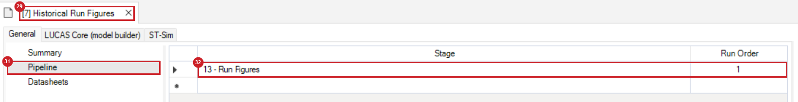

*Figure 5.13. The Run Figures scenario and its pipeline: stage 13 alone.*

4. On the **LUCAS Core (model builder)** tab, open **Run Figures** (33) and pick the run from the **Run to draw** drop-down (34). It lists this project's historical runs and projections, newest first, with their result Ids. For the historical run figures, pick `[6] P26 - Historical`. Figure 5.14 shows the same page in the projection's Run Figures scenario (section 7.2), drawing result `[13]`. Leave it at **(the newest run)** to draw the newest run in the library.
5. Save the library and run the scenario. It takes about a minute for P26.
6. Open the result: the figures are under **LUCAS Core > Build Results > Run Figures (PNG)**, in the figure viewer (section 9.1). The files are in the library's data folder, under `<library>.ssim.data\Scenario-<result id>\lucasCore_OutputRunFigure`.

![The Explorer with \[14\] Projection Run Figures selected in the Figures folder, marked 30; the LUCAS Core (model builder) tab with Run Figures marked 33; the Run to draw drop-down set to \[13\] P26 - Projection No Climate, marked 34, with a note below it](images/fig-5.14.png)

*Figure 5.14. A Run Figures scenario and the run to draw, picked from the drop-down (here the no-climate projection, result 13).*

7. To save them all to a folder, select the result scenario in the Explorer. In the panel below the Explorer, open the **Export** tab (35), select **LUCAS Core > Run Figures (PNG)** (36) and click **Open** (37), then choose the folder to copy the PNGs into, as in section 4.4.


*Figure 5.15. Exporting the run figures to a folder.*

**Examples from the P26 historical run.** Four of the nine figures stage 13 draws for the P26 historical run (result 6, 1985 to 2023, one iteration):


*Figure 5.16. Land cover change: (a, b) state class in 1985 and 2023; (c) the change between them. The run urbanized 243 km², and harvested 1,917 km² of forest that stayed forest.*


*Figure 5.17. Total ecosystem carbon: (a, b) carbon density in 1985 and 2023 (439.3 and 444.4 Tg C); (c) the change, +5.1 Tg C. Losses follow the large fires of the north and centre; most of the remaining forest gained carbon.*


*Figure 5.18. Carbon fluxes: (a) net primary productivity, heterotrophic respiration and net ecosystem productivity; (b) fire emissions and harvest losses, and net biome productivity, a mean of +0.13 Tg C per year. Fire emissions in 2020 and 2021 turned the study area into a carbon source.*

The run's **Transitions per year** figure compares each family with the Build's Historical Transition Summary, which the stage reads from its dependency. With the run result as the dependency instead of the Build result, the figure shows the run's bars alone. For a Build made before 24 October 2026, the summary double counts urbanization and intensification (section 5.5) until the Build's stage 6 is rerun.


*Figure 5.19. Transitions per year: each family's simulated area (bars) against the Build's historical record (points), with the 1986-2023 totals in each panel title. Urbanization, intensification, agriculture and fire follow the record year by year; harvest falls short in most years (8% over the run).*

## 6. The Projection Setup

The Projection Setup prepares everything a projection needs, once, so that any number of projections can then run on it as ST-Sim alone (chapter 7). It is a preparation scenario with two stages:

- **9 - Projection Transitions** sets how much of each transition happens in each unit and projection year, by drawing whole historical years from the Build's record. It also makes the **hand-over**: the historical run's final state class, age and stock maps become the projection's starting conditions.
- **10 - Transition Suitability** sets where the transitions go: a suitability surface for each land-use group, fitted on the annual NLCD record, and the historical patch sizes.

A Projection Setup is made once per historical run it starts from and per set of projection rules. It depends on the Build result, and names the historical run on its Run Settings page (section 6.2).

> The hand-over needs the historical run's state class, age and stock maps for its last year (2023 for P26). Age maps are on by default for Builds run from 25 October 2026; for an older Build, tick **Ages** on the run's Spatial output page before running it (section 5.2).

### 6.1 Create the Projection Setup scenario

1. Right-click **Definitions**, choose **New > Folder** and name it `Projection Setup`, as for the Figures folder (section 4.4). Right-click the folder, choose **New > Scenario** and name it (1), for example `P26 - Projection Setup No Climate`.
2. Add the **Build result** as its dependency (2), as for the historical run (section 5.1). Do not add the historical run: the setup reads its maps from the library, by the result id you enter in section 6.2.
3. On **General > Pipeline** (3), untick **Inherit values**, choose **No Data**, and add **9 - Projection Transitions** with Run Order 1 and **10 - Transition Suitability** with Run Order 2 (4).


*Figure 6.1. The Projection Setup scenario: the Build result as its dependency and stages 9 and 10 as its pipeline.*

### 6.2 Run Settings

Run Settings sets the projection years, where the projection starts, the Monte Carlo iterations and the spatial tiles.

4. On the **LUCAS Core (model builder)** tab, open **Projection > Run Settings** (5).
5. **End year** (6): the last projection year; blank runs to 2100. Projections start the year after the Build's historical end (2024 for P26). The P26 example runs to `2050`.
6. **How the projection starts** (7): choose **Stand-alone** and pick the historical run from the list: the result scenario of section 5 that has age maps (`[6] P26 - Historical` for P26). Stage 9 copies that run's 2023 state class, age and carbon stock maps into the setup as the projection's starting conditions, so the history is run once and every projection shares it. (**Continuous** is for a projection that runs the historical years itself in the same run; it is rarely needed.)
7. **Historical years drawn**: leave **All historical transition years** ticked, or give a shorter reference period (for example `2001` to `2023`). Each projection year draws one whole historical year from this period; groups in the same sampling set draw the same year, so a year's land use keeps its real mix.
8. **Iterations** and **Random seed** (8): each iteration draws its own sequence of historical years, and the same seed gives the same draws. Use `1` for a first test, as here, and 10 or more for a Monte Carlo set.
9. **Transition types within a named group**: leave **Weight each type by its historical share**, so urbanization keeps the historical mix of open, low, medium and high intensity.
10. **Spatial multiprocessing** (9): the tiles come from the Build's Build Options, so the box is already ticked with 5 tiles of whole **Secondary: Counties** units for P26. Change the number or the level only to tile this projection differently; untick it for one job.


*Figure 6.2. Run Settings for the P26 Projection Setup.*

**What the tiles do.** Tiles let one projection run in pieces at the same time, one ST-Sim job per tile, joined when they finish. When the setup runs, stage 9:

- **Packs whole units into N tiles.** It takes the counties from largest to smallest and puts each into the tile that is smallest so far. A county is never split, and the tiles come out roughly equal in area.
- **Writes the tile map into the setup's result** (System > Spatial Multiprocessing). Every projection that depends on the setup inherits it and is tiled with nothing to browse to; for the historical run you set this map by hand (section 5.3).
- **Sets every Target group's Target Strata to the tile level.** A transition target is an area per unit and year, and it adds up only when each unit lies wholly inside one tile, so tiles and targets must use the same strata level. Probability groups, such as fire, are exempt.

A run waits for its largest tile, so the speed-up is set by the largest tile, not the number of tiles. P26's largest county, Plumas, holds 19.8% of the cells (Table 5.1), so no tile can be smaller than that:

| Tiles (N) | Largest tile | Speed-up | Packing |
| --- | --- | --- | --- |
| 2 | 50% | 2.0× | two halves of 8 and 9 counties |
| 4 | 25% | 4.0× | for example Plumas, Lassen and Washoe in one tile |
| 5 | 20% | 5.0× | Plumas and Carson City in one tile; El Dorado, Butte and Washoe in another |
| 6 to 17 | 19.8% (Plumas alone) | 5.1× | more jobs, no faster |

*Table 6.1. P26's counties packed into N tiles, by share of the study area's cells; the speed-up assumes a job's time grows with its cells.*

Five tiles are enough for P26: more add jobs, memory and merging time without finishing sooner. It is the same count the Build used for the historical run's tiles (section 5.3).

> Tiles split each iteration, so a projection runs tiles × iterations jobs (5 tiles × 10 iterations = 50). Library multiprocessing must be on with that many jobs allowed, and the memory guidance of section 5.3 applies: each P26 tile holds about a fifth of the cells, about 4 GB per job at 150 m. Choosing the tile level here also changes the Target Strata on the Transitions page (section 6.3).

### 6.3 Transitions

The Transitions page has two tables: how much of each transition happens each year (stage 9), and where it goes (stage 10). Both start filled with the package defaults, which P26 uses unchanged.

11. Open **Projection > Transitions** (10).
12. **How much changes each year** (11): one row per transition group.
    - **Method**: *Target* gives the group the area it had in the drawn historical year, per unit of the **Target Strata** (here Secondary, the counties); *Probability* gives it the burned or changed fraction of each **Rate Unit** (here pyromes) as a map; *None* turns it off after the historical end.
    - **Sampling Set**: groups with the same name draw the same historical year, so a year's land use, harvest and fire each keep their real mix. The defaults give land use, harvest and fire a set each.
    - **Excluded GAP**: protected-area status codes where the transition may not happen (`1|2|3` keeps urbanization and agricultural expansion off GAP 1-3 land).
13. **Where it goes** (12): one row per group, or per member type, to place. **Fitted** builds a suitability surface by regression on the historical record (fitting settings on the Spatial Allocation page, section 6.4); rows with the same **Surface** share one surface. **Source** and **Event Classes** define a historical event (the NLCD class a cell had the year before, and the class it changed to, or an LCMS tree-removal code for harvest). **Adjacency** makes a cell more likely next to developed land (or agriculture, for agricultural events), updated during the run. **Size Distribution** places patches of the historical sizes. The table scrolls: the urbanization rows are below the harvest rows.
14. **Reset to defaults** (13) restores both tables from the package defaults.


*Figure 6.3. The Transitions page: how much changes each year (stage 9) and where it goes (stage 10).*

*Table 6.2. The default projection rules (defaults/projection/transitions.csv and allocation.csv).*

| Group | How much (stage 9) | Sampling set | Not on GAP | Where (stage 10) |
| --- | --- | --- | --- | --- |
| Urbanization | Target, counties; one area for all four types | Land use | 1-3 | Fitted: one surface for Low, Medium and High (NLCD 22-24), one for Open Space (21); adjacency on |
| Intensification | Target, counties | Land use | - | Random among developed cells |
| Ag Expansion | Target, counties | Land use | 1-3 | Fitted: natural classes to NLCD 81-82; adjacency on |
| Ag Contraction | Target, counties | Land use | - | Fitted: NLCD 81-82 to natural classes |
| Forest clearcut | Target, counties | Harvest | 1-2 | Fitted: forest with LCMS stand-replacing removal |
| Forest selection | Target, counties | Harvest | 1-2 | Fitted: forest with LCMS partial removal |
| Fire | Probability, pyromes; one rate map per severity | Fire | - | The rate maps themselves (fire methods: section 6.5) |

With spatial tiles on (section 6.2), the Target Strata of every Target row follow the tile level; here both are the counties. A group with no row in the lower table is placed at random within its units.

> **Insect** is listed among the project's transition groups but has no row here, because the Build has no insect pathways: lucasCore ships six pathway sets (urbanization, intensification, agricultural expansion and contraction, harvest and fire), so insect disturbance never happens, in the historical run or in projections.

### 6.4 Spatial Allocation

The Spatial Allocation page sets how stage 10 fits the suitability surfaces of the **Fitted** rows on the Transitions page. Each surface is a logistic regression of where the historical events happened, against covariates such as distance to developed land and slope. P26 uses the defaults.

15. Open **Projection > Spatial Allocation** (14).
16. **Settings for** (15): **Every surface**, or one surface (Urbanization, Open Space, Ag Expansion, Ag Contraction, Clearcut, Selection) to give it settings of its own.
17. **Fit the regression on** (16): the region the surfaces are fitted on. The study area is the default. A small study area has few change events, so fit it on a larger region instead (its pyrome, neighbouring counties, or the state) by choosing the kind of unit and adding the units.
18. **Fitting** (17):
    - **Fitting resolution**: 30 m is native NLCD; a coarser resolution fits faster. P26 uses 150 m, the model's own cell size (section 6.6 compares it with 30 m).
    - **Out-of-sample test years**: the last N historical years (11) are held out, the surface is fitted on the earlier years and scored on the later change, then refitted on all years.
    - **Leave out burned pixels**: pixels inside a fire perimeter of the last 3 years are left out, because NLCD relabels burned forest as developed open space for a few years.
    - **Unchanged pixels per year**: the controls sampled against the change events (25,000).
    - **Agriculture flicker window**: an agricultural event that undoes a change of the last 5 years is NLCD flicker, not change, and is dropped.
    - **Place patches**: the historical events of each year are joined into patches, and their sizes in model cells become ST-Sim size distributions, so a 150 m model places patches rather than scattered cells.
19. **Covariates** (18): the covariates every surface uses (distance to developed land, developed share within 1 km, housing density, distance to roads, slope, elevation, land cover, GAP status, county). Choose a surface under **Settings for** to add or drop covariates for it alone; by default the agricultural surfaces add distance to agriculture, agriculture share within 1 km and crop productivity (NCCPI), and the harvest surfaces add forest owner type. **Add raster** adds a covariate of your own.
20. **Adjacency** (19): for groups with Adjacency ticked on the Transitions page, the share of developed land (or agriculture) within the neighbourhood radius (blank = 3 model cells) raises a cell's suitability, recomputed every 5 years during the run.

The **Rule weights** table at the bottom applies only to groups whose method is **Rules** (a weight per WUI class and GAP status, multiplied); with the default Fitted surfaces it is not used.


*Figure 6.4. Spatial Allocation: the fitting region, fitting settings, covariates and adjacency of the suitability surfaces.*

### 6.5 Fire

The Fire page chooses how projected fire is made. Fire is a Probability group (section 6.3): each projection year burns a share of every pyrome, set by the historical year drawn for the fire sampling set.

21. Open **Projection > Fire** (20).
22. **Fire method** (21). **Fire group** shows (Fire), the default: the Fire transition group. Choose one of three methods:
    - **1. Historical rates**: each year burns the drawn historical year's share of each pyrome, with that year's own mix of low, medium and high severity. With **Slope selectivity**, a cell's fire probability is scaled by how much more (or less) its slope burned in the historical record, rescaled so the pyrome's burned area holds.
    - **2. Burn probability** (P26): as method 1, but a burn-probability map guides where fire spreads and starts. It already holds terrain and fuels, so it replaces slope selectivity.
    - **3. lucasFireC2F seasons**: each year takes a whole fire season simulated by a lucasFireC2F run (perimeters and severity), drawn per projection year and iteration.

    Methods 1 and 2 size the fires from the interagency fire perimeters, as an ST-Sim size distribution from the first projection year.
23. **Method 2: burn probability** (22). Leave **Burn probability raster** blank to use the Data Sources burn probability (FSim CONUS, LF2020, 270 m), or browse to another (a Wildfire Risk to Communities or lucasFireC2F burn probability). **Ignitions from**: the burn probability itself (default), or the FPA-FOD ignition density, the recorded fire origins smoothed with a Gaussian of the **Ignition smoothing** width (blank = 5,000 m).

Method 3 needs a finished lucasFireC2F run: its library and the result scenario whose per-burn effects table it uses.


*Figure 6.5. Fire: method 2, burn probability, with the Data Sources FSim map and ignitions from the burn probability.*

### 6.6 Run and check the Projection Setup

24. Save the library and run the Projection Setup scenario (section 4.1). Its result appears under the scenario's **Results** folder (23), and the Run Monitor shows its Result Id and status (24). The P26 setup is result `[11]`. Projections (chapter 7) depend on this result.


*Figure 6.6. The Projection Setup's result.*

The warning triangle on the result is SyncroSim's note that the lucasCore package does not state the SyncroSim version it was built for; it appears on every lucasCore result and can be ignored.

**Time.** The P26 setup took 34 minutes: 14 for stage 9 and 20 for stage 10 (25, 26), which fitted six surfaces at a 150 m fitting resolution. Most of stage 10's time went on building its covariate layers for the first time (annual NLCD, distances, housing, NCCPI from Planetary Computer). It caches them per fitting resolution in the library's data folder (`lucasCore-suitability`), so a rerun at the same resolution is faster. An earlier P26 setup fitted at 30 m, about 55 million cells, and its stage 10 took 44 minutes.


*Figure 6.7. The end of the Projection Setup's run log.*

**Checking the result.** Open the result scenario and the **LUCAS Core > Build Results** pages it wrote:

- **Suitability Summary** (27): for each surface, the events and controls it was fitted on, the deviance explained, and the out-of-sample test: the surface is fitted on 1986-2012, mapped from 2012, and scored on the change of 2013-2023 (28). AUC is the chance that a cell that changed scores higher than one that did not (0.5 = random); the top 1% and top 10% shares say how much of the test change fell on the most suitable land.


*Figure 6.8. Suitability Summary: how well each surface placed the held-out change.*

*Table 6.3. The P26 surfaces, scored on the change of 2013-2023: fitted at 150 m, with the earlier 30 m fit in brackets.*

| Surface | Test change (km²) | Test AUC, 150 m (30 m) | Change in the top 10% of land, 150 m (30 m) |
| --- | --- | --- | --- |
| Urbanization (Developed Low, Medium, High) | 8.3 | 0.93 (0.87) | 81% (63%) |
| Open Space | 35.3 | 0.91 (0.86) | 68% (61%) |
| Clearcut | 137.9 | 0.85 (0.83) | 61% (54%) |
| Selection | 202.1 | 0.72 (0.72) | 30% (27%) |
| Ag Contraction | 3.0 | 0.85 (0.84) | 42% (43%) |
| Ag Expansion | 0.7 | 0.999 (0.996) | 100% |

Every surface beats random placement, and the 150 m fit scores as well as the 30 m fit or better, in a third of the time. The two are not a strict comparison: the 30 m fit came from an earlier P26 Build, and at 150 m the change is counted in 150 m cells, so the test areas differ. Agriculture is rare in P26, and Ag Expansion's near-perfect score rests on under 1 km² of test change, so it says little. For a 150 m model, P26 uses 150 m: the surfaces are fitted on the grid the transitions run on.

- **Projection Rates** (29): for each group and unit, the mean, minimum and maximum annual area over the reference years, and the share of the land eligible for it. Fire is a rate per pyrome (30): P26 burned 319 km² a year on average and up to 3,608 km² (2021), the range the projection draws from.


*Figure 6.9. Projection Rates: the historical areas each group draws from, per county or pyrome.*

- **Projection Schedule** (31): the historical year drawn for each iteration, projection year and sampling set (32). In 2024 the P26 setup burns like 2008, harvests like 2014 and develops like 2010. The same random seed gives the same schedule.


*Figure 6.10. Projection Schedule: the historical year each projection year draws, per sampling set.*

- **Historical Patch Sizes** (33): the historical events joined into patches, counted by size class in model cells, and written as an ST-Sim size distribution (34). At a 150 m fitting resolution every placed group gets one: 56% of clearcut's 15,140 patches span more than one cell (up to 50 cells), 36% of selection's (up to 100), 14% of agricultural contraction's and 6% of urbanization's. In the earlier 30 m fit only clearcut got one (12% of its patches spanned more than one model cell); the other groups were placed cell by cell.


*Figure 6.11. Historical Patch Sizes: the size classes of each group's historical patches, in model cells.*

- **System > Spatial Multiprocessing** (35): stage 9 has filled in the tiling raster, `Projection-Tiles.tif` (36), the five county tiles of section 6.2. Every projection on this result inherits it.


*Figure 6.12. The tile map stage 9 wrote, inherited by every projection.*

- **Validation** (37): stage 9's and stage 10's checks (38). Every one should read Pass: each draw is a reference year, every group has a target or rate, the historical run's maps are on the Build's grid, the Target groups use the tile strata, each surface beats random placement, and every placed group has a multiplier from 2024.


*Figure 6.13. Validation: every check of stages 9 and 10 passed.*

## 7. Projections

A projection is an ST-Sim run from the historical end year forward. Like the historical run, it runs ST-Sim alone: its dependencies supply every input. The Projection Setup result supplies the starting maps, the drawn transition amounts, the suitability surfaces and the tiles; the Build result supplies the pathways, growth, flows and stock-flow settings. This chapter first runs a projection at normal climate (section 7.1), then adds a climate future (section 7.3).

**What varies between iterations.** Each iteration has its own sequence of drawn historical years for each sampling set, so the amounts of land-use change, harvest and fire (with its severity mix) differ between iterations. Even with the same amounts, ST-Sim places the change in different cells each iteration, weighted by the suitability surfaces, and fires start and spread differently. The starting maps, the growth and carbon parameters and, here, the climate are the same in every iteration.

> **The draws are made by the Projection Setup, not the projection.** A projection can run only as many iterations as its setup drew: the P26 setup drew 1 (section 6.2), so the projection here runs 1. A projection with more iterations than its setup would have no transition targets in the extra iterations, and a Target group without a target lets every eligible cell transition. For a Monte Carlo set, set **Iterations** to 10 or more in the setup's Run Settings, rerun the setup, and give the projection the same number.

### 7.1 A projection at normal climate

1. Right-click **Definitions**, choose **New > Scenario** and name it (1), for example `P26 - Projection No Climate`.

![The New Scenario dialog with the name P26 Projection 2024-2050 - No Climate \[1MC\] marked 1](images/fig-7.1.png)

*Figure 7.1. Naming the projection.*

2. Add two dependencies (3) so that the Dependencies folder lists, from the top, the **Projection Setup result** (`[11]`), then the **Build result** (`[2]`). Studio puts each new dependency at the top of the list, so add them in reverse: drag the Build result onto the scenario first, then the setup result. The new scenario is marked (2).


*Figure 7.2. The projection's dependencies: the setup result first, then the Build result.*

> **Dependency order matters.** For each page, a scenario takes the data of the first dependency that has any, and the next dependency only fills the pages the first lacks. Several pages exist in both results with different contents: initial conditions and initial stocks (the setup's are the historical run's 2023 maps, the Build's are 1985), transition spatial multipliers (the setup's include the suitability surfaces and projection maps from 2024), transition targets and state attribute values. With the setup first, the projection starts from 2023 with the projection rules; with the Build first, it would restart from the 1985 landscape with no projection targets.

3. On **General > Pipeline** (4), untick **Inherit values** (the pipeline is otherwise inherited from the setup: stages 9 and 10), choose **No Data**, and add **ST-Sim** as the only stage (5).


*Figure 7.3. The projection's pipeline: ST-Sim alone.*

4. On the **ST-Sim** tab, **Run Control**: start year `2023` (the historical end), end year `2050` (the setup's end year), **Total iterations** `1` (as many as the setup drew), and tick **Run model spatially**.


*Figure 7.4. Run Control: 2023 to 2050, one iteration, spatial.*

5. **Output Options > Tabular** (6): tick **State classes every** `1` and **Transitions every** `1` years (7), as for the historical run.


*Figure 7.5. Yearly state class and transition tables.*

6. **Output Options > Spatial** (8): check that **State classes**, **Ages** and **Transitions** are ticked every `1` years (9). The Build result supplies them (Builds run from 25 October 2026); for an older Build, tick them here. The age maps are what a later Projection Setup would hand over.


*Figure 7.6. Yearly state class, age and transition maps.*

7. **Output Filters > Transition Groups** (10): the transition group output filter, with maps (Spatial and Spatial Probability) only for the main families and the two harvest type groups (11), as in section 5.2. The Build result supplies it (Builds run from 24 October 2026), so there is nothing to set. For an older Build, copy the rows from the historical run's filter page (select all, copy) and paste them here: without a filter, ST-Sim maps all \~158 transition groups every year.


*Figure 7.7. The transition group output filter.*

The stock and flow outputs (yearly tables and average stock and flow maps) come from the Build result, and the tiles from the setup result (section 6.2). With library multiprocessing on, the projection runs as 5 tile jobs per iteration.

8. Save the library and run the projection.

### 7.2 The projection's result

The P26 projection (`[13]`, 2024-2050, one iteration) ran as 5 tile jobs in 2 hours 1 minute: 1:54:51 running the jobs and 5:39 merging them into one result. Over the 27 years it burned 9,943 km² (368 km² a year; the drawn years 2025 and 2031 add 1,514 and 3,602 km²), harvested 1,729 km² and urbanized 172 km². Ecosystem carbon starts at 443.2 Tg C, falls to 431.1 after the 2031 fire year and ends at 445.1 Tg C in 2050..

**Run Figures of a projection.** Run Figures (section 5.6) works on a projection as on a historical run. In the Run Figures scenario, pick the projection's result in the **Run to draw** drop-down (or leave it at **(the newest run)**). For a stand-alone projection, stage 13 finds the historical run it started from, through its Projection Setup's Projection Start, and puts it in front, so one set of figures runs from 1985 to the end of the projection. A dashed line marks where the projection starts.

**Examples from the P26 projection.** Four of the nine figures for the historical run joined to the normal-climate projection (one iteration, 1985-2050):


*Figure 7.8. Land cover change, 1985-2050: (a, b) state class in 1985 and 2050; (c) the change between them. 418 km² urbanized and 3,194 km² of forest harvested at least once over the 65 years.*


*Figure 7.9. Transitions per year. Titles give the area simulated to 2023 + the area projected after it, and the record in brackets. Each projected year repeats the amount of a drawn historical year: fire's spikes in 2025 and 2031 (1,514 and 3,602 km²) are draws of 2020 and 2021.*


*Figure 7.10. Carbon stocks, 1985-2050: 439 to 445 Tg C. The 2031 loss (about -9 Tg C) is that year's draw of the 2021 fire season; the stocks recover to 445 Tg C by 2050.*


*Figure 7.11. Carbon fluxes, 1985-2050. (a) Productivity and respiration vary from year to year up to 2023 and are almost flat after it. (b) Losses to fire and harvest, and net biome productivity (mean +0.11 Tg C a year).*

**Why the fluxes flatten after 2023.** Up to 2023, productivity and decay follow each year's PRISM weather through the climate flow multipliers. This projection has no climate future, so from 2024 every multiplier is 1.0: each year has the climate the growth curves and decay rates were fitted to. Only disturbance and stand age still move the fluxes, so net primary productivity, respiration and net ecosystem productivity change slowly, and the year-to-year variation of the historical period is gone. Net biome productivity still swings with the drawn fire years, because fire is not climate-driven here. Adding a climate future (section 7.3) brings back year-to-year climate and any trend the climate model projects.

### 7.3 Adding a climate future

Climate enters lucasCore as yearly **flow multipliers**: maps that scale forest growth, non-forest growth and decomposition in each cell. The Build's Climate Options (section 3.4) choose the effects; P26 uses the defaults:

| Multiplier (flow group) | What it scales | Climate effect |
| --- | --- | --- |
| Net Growth Forest: Total | forest growth | tree-ring response to temperature and precipitation |
| Net Growth Non Forest: Total | shrub and grass growth | Miami model of net primary productivity |
| Q10 Fast Flows | decay of the fast dead pools (litter, fine woody debris) | Q10 temperature response |
| Q10 Slow Flows | decay of the slow pools (soil) | Q10 temperature response |

*Table 7.1. The climate flow multipliers.*

For 1985-2023 the Build writes them from PRISM (stage 7), one set of maps per year. From 2024 it writes `One.tif`, a multiplier of 1.0 everywhere: the climate the growth curves and decay rates were fitted to. That is the normal climate the projection of section 7.1 ran under. A **Projection Climate** scenario (stage 11) replaces those 1.0 maps with maps from one LOCA2 climate run: a scenario (SSP), a climate model and a replicate. Each year's multiplier is the LOCA2 run's anomaly against that climate model's own 1991-2020 normal (the delta method), so 1.0 still means the fitted climate, the series joins the PRISM years without a step from model bias, and only the change the climate model projects reaches the carbon.

Each climate future is its own small scenario on the Build result, so one Build and one Projection Setup serve any number of them.

**Make the climate future.**

9. Right-click **Definitions** (or a folder for the climate futures, here **Climate**), choose **New > Scenario** and name it after the run (12), for example `Climate - CanESM ssp245`.
10. Add the **Build result** (`[2]`) as its only dependency (13). It supplies the grid, the historical end year and the climate effects.


*Figure 7.12. The Projection Climate scenario and its one dependency, the Build result.*

11. On **General > Pipeline** (14), untick **Inherit values**, choose **No Data**, and add **11 - Projection Climate** as the only stage (15).


*Figure 7.13. The Projection Climate pipeline: stage 11 alone.*

12. On the **LUCAS Core (model builder)** tab, open **Projection > Climate** (16) and choose the LOCA2 run (17): the **Scenario (SSP)**, the **Climate Model** (the line below the fields lists the SSPs and replicates that model has), and the **Replicate** (blank = the lowest-numbered replicate with that SSP). Set **Last Year** to at least the projection's end year (blank = 2100). The P26 example uses SSP2-4.5, CanESM5, r1i1p1f1, to 2050. **Rescan LOCA2 folder** updates the lists after runs are added to or removed from the LOCA2 folder.


*Figure 7.14. The LOCA2 run of the climate future.*

13. Save and run. Its result holds the flow multipliers for 2024 to the Last Year. For P26 (`[18]`) it took 4.5 minutes and wrote 109 maps (42 MB). The run log gives each multiplier's mean in the first and last projected decade: under CanESM5 SSP2-4.5, forest growth is 1.07 in 2024-2033 and 1.00 in 2041-2050, non-forest growth 1.15 and 0.90, and decay of the fast and slow pools rises to 1.26 and 1.18.

> The lists of scenarios, models and replicates come with the package, from the LOCA2 runs on the machine lucasCore was developed on. Stage 11 reads the run from the LOCA2 folder in Data Sources and stops with a clear message, naming the models or replicates that do have the chosen SSP, if the run is not on this machine.

**A second climate future, by copying the first.** A copy keeps the Build dependency, the stage 11 pipeline and the LOCA2 run, so only the name and the run need changing:

- Right-click the climate scenario and choose **Copy**, then right-click the folder (here **Climate**) and choose **Paste**. The copy is named after the original with `  - Copy ` added.


*Figure 7.15. Pasting a copy of the climate scenario into the Climate folder.*

- Open the copy and, on **General > Summary**, rename it, for example `Climate - CanESM ssp585`.


*Figure 7.16. Renaming the copy.*

- On **Projection > Climate**, change the **Scenario (SSP)**, here to SSP5-8.5, and keep the climate model, replicate and last year. Save and run.


*Figure 7.17. The copy's LOCA2 run, changed to SSP5-8.5.*

**Run a projection with it.**

14. Right-click **Definitions**, choose **New > Scenario** and name it after the climate future, for example `P26 - Projection CanESM ssp245`.
15. Add three dependencies that list, from the top: the **Projection Setup result**, the **Projection Climate result**, then the **Build result**. Studio puts each new dependency at the top, so add them in reverse: the Build result, then the climate result, then the setup result.
16. Set the scenario up as the projection of section 7.1; a new scenario inherits none of these choices:
    - **General > Pipeline**: untick **Inherit values**, choose **No Data**, and add **ST-Sim** as the only stage (otherwise the pipeline comes from the setup: stages 9 and 10).
    - **ST-Sim > Run Control**: start year `2023`, end year `2050`, total iterations `1` (as many as the setup drew), and tick **Run model spatially**.
    - **Output Options > Tabular**: state classes and transitions every `1` year.
    - **Output Options > Spatial**: state classes, ages and transitions every `1` year.
    - **Output Filters > Transition Groups**: the transition group output filter, for a Build made before 24 October 2026 (copy the rows from the historical run, as in section 7.1).
17. Save and run.

The P26 example runs two climate futures of one climate model, CanESM5: a moderate scenario, SSP2-4.5 (`[19]`, 18), and a high-emission scenario, SSP5-8.5 (`[22]`, 20). Each has its own Projection Climate result (`[18]` from `Climate - CanESM ssp245` and `[21]` from `Climate - CanESM ssp585`), and each projection lists its dependencies in the same order: setup, climate, Build (19, 21). The Projection Climate scenarios are kept in a **Climate** folder in the Explorer.


*Figure 7.18. Two climate projections on one Projection Setup: SSP2-4.5 and SSP5-8.5, each with its own Projection Climate result between the setup and the Build.*

> **Why this order.** The setup result has no flow multipliers, so the climate result supplies them, ahead of the Build's 1.0 maps. The climate result was made on the Build result and carries copies of its pages, including its 1985 initial conditions, so it must come after the setup result, whose 2023 starting maps must win. With the climate result first, the projection would start from the Build's 1985 landscape.

To compare climate futures, make one Projection Climate scenario per SSP and model, and one projection on each, all on the same Projection Setup result. They differ only in their flow multipliers, so the differences in carbon are the climate's.

**Running climate futures side by side.** Projections are ST-Sim-only scenarios, so SyncroSim can run several at once, and each still splits into its spatial tiles.

18. Double-click the library in the Explorer, open **System > Multiprocessing > General** (22), and tick **Run multiple scenarios in parallel** (23), with **Enable multiprocessing** on and enough jobs for every tile of every scenario (5 tiles × 2 projections = 10 jobs for P26; 40 here).


*Figure 7.19. Library multiprocessing set to run several scenarios at once.*

19. Save, select the projections in the Explorer (24: Ctrl-click or Shift-click), right-click and choose **Run** (25).


*Figure 7.20. Running the two climate projections together.*

The **Run Monitor** lists both scenarios (26), each with its own result (P26: `[23]` and `[24]`), and below them all 10 tile jobs, 5 per scenario, running side by side (27). Plan memory for all of them at once (section 5.3): for P26, about 2 GB per job, so about 20 GB for 10 jobs. Running both projections together costs no extra time: for P26 each finished in 1 h 59 min (tile jobs 1 h 44–46 min, merge 7 min), against 2 h 1 min for the no-climate projection run alone.


*Figure 7.21. Two climate projections running at once: 5 tile jobs each.*

### 7.4 Comparing runs (stage 14)

Stage 14 draws one set of figures that puts several runs side by side:

- total ecosystem carbon, and each run's difference from a baseline run;
- a map of that difference in the final year;
- the carbon fluxes, per year and by decade;
- the transitions, carbon by pool and land cover change;
- a summary table.

Like Run Figures (section 5.6), it is a scenario of its own that depends on the Build result. It reads the runs' results and does not run ST-Sim.

1. Right-click the **Figures** folder, choose **New > Scenario** and name it (28), for example `Compare Projection Scenarios`.


*Figure 7.22. Naming the comparison scenario.*

2. Add the Build result as its dependency: drag `[2] P26 - Build (...)` from the Build's **Results** folder onto the new scenario (29). It appears under **Dependencies** (30). Stage 14 takes the model grid from it; the runs to compare are chosen on the scenario's own page.

![The Explorer with \[32\] Compare Projection Scenarios in the Figures folder, marked 29, and the Build result \[2\] under its Dependencies folder, marked 30](images/fig-7.23.png)

*Figure 7.23. The comparison scenario in the Figures folder, with the Build result as its only dependency.*

3. On **General > Pipeline** (32), untick **Inherit values** and choose **No Data** when Studio asks (31). Then add **14 - Compare Runs** as the only stage, with Run Order 1 (33).


*Figure 7.24. Studio asks what to do with the pipeline it inherited: choose No Data.*


*Figure 7.25. The comparison scenario's pipeline: stage 14 alone.*

4. On the **LUCAS Core (model builder)** tab, open **Compare Runs** (34). The page starts empty. Click **Add a run** (35) once for each run to compare.


*Figure 7.26. The Compare Runs page before any run is added.*

5. Each run gets a line. Set it up from left to right:

- **✕** (36) removes the run.
- **Run** (37): pick the run from the drop-down. It lists the project's historical runs and projections, newest first, with their result Ids. For P26, pick the three projections: `[24]` SSP5-8.5, `[23]` SSP2-4.5 and `[13]` no climate.
- **Baseline** (38): tick the run the others are compared with. Ticking one clears the others. For P26, tick the no-climate projection `[13]`. With none ticked, the first projection in the list is the baseline, and the page says so beside it.
- **Colour** (39): **auto** takes the default palette (blue, orange, red, and so on, in list order). Click the swatch to choose a colour; right-click it to go back to auto.
- **Label** (40): the name used in the figures' legends. Blank uses the scenario's name. For P26: `No Climate`, `CanESM ssp245` and `CanESM ssp585`.

**Add a run** (41) adds another line.

![The Compare Runs page with three runs: \[24\] CanESM ssp585, \[23\] CanESM ssp245 and \[13\] No Climate. Marks: 36 the remove buttons, 37 the run drop-downs, 38 the Baseline ticks with No Climate ticked, 39 the Colour swatches set to auto, 40 the labels, 41 the Add a run button](images/fig-7.27.png)

*Figure 7.27. The three P26 projections set up for comparison, with the no-climate run as the baseline.*

The historical run does not need a line. Stage 14 finds the historical run each projection started from (through its Projection Setup's Projection Start; for P26, result `[6]`). It draws that run in black from 1985 to the projections' start year, and the projections in colour after it. Add the historical run only to give it its own label or colour.

6. Save the library and run the scenario. For P26 it takes about a minute.

The figures are under **LUCAS Core > Build Results > Compare Figures (PNG)**, in the figure viewer (section 9.1). The two summary tables are also outputs, one row per run:

- **Compare Carbon Summary**: carbon at the start and end of the run, its change and its difference from the baseline; the change in live biomass and in dead wood, litter and soil; and mean annual NPP, NEP, losses to land-use and land-cover change (fire emissions and harvest) and NBP.
- **Compare Land Change Summary**: the area burned, harvested and urbanized, and the change in forest and developed area.

To save the figures to a folder, use **Export > LUCAS Core > Compare Figures (PNG)**, as for Run Figures.

The P26 comparison is result `[36]`. It took 55 s and drew 9 figures. Its log lists each run and its role: the historical run `[6]`, added automatically, then the baseline `[13]` and the two climate projections. It also checks that the projections end in the same year.


*Figure 7.28. Total ecosystem carbon in the P26 runs, and each climate run's difference from the no-climate baseline.*

In P26, both climate futures end with less carbon than the no-climate run (Figure 7.28): 7.2 Tg C less under SSP2-4.5, and 5.0 Tg C less under SSP5-8.5. SSP5-8.5 is the lower of the two until about 2045, about 11 Tg C below the baseline in 2041. It then gains on the baseline, because its growth rises in the last decade. The difference map (Figure 7.29) shows where these gaps lie in 2050.


*Figure 7.29. Total ecosystem carbon in 2050: the baseline, and each climate run minus the baseline.*

The carbon summary (Figure 7.30) shows why. Both climate runs grow more than the baseline: NPP averages 10.6 Tg C per year against 10.3, and live biomass gains 3.9 and 6.9 Tg C against 2.2. But warmer years also speed decay, so dead wood, litter and soil lose 9 to 10 Tg C, where the baseline holds steady. The loss to fire and harvest is about 1.6 Tg C per year in every run, so net biome productivity turns slightly negative under both climate futures.


*Figure 7.30. The carbon summary of the comparison (also the Compare Carbon Summary output).*

The land change summary (Figure 7.31) shows that the three projections burn, harvest and urbanize the same area, and so lose the same forest (about 120 km²) and gain the same developed land (172 km²). Climate changes growth and decay here, not disturbance.


*Figure 7.31. The land change summary of the comparison (also the Compare Land Change Summary output).*

## 9. Viewing results in SyncroSim

Results can be viewed without leaving SyncroSim Studio in two ways: the lucasCore figures, drawn by stages 12, 13 and 14 (section 9.1), and the charts and maps you build yourself from a run's ST-Sim output (section 9.2).

### 9.1 The figures

Stages 12 (Build Figures), 13 (Run Figures) and 14 (Compare Runs) save their figures as PNG files in the result scenario. Studio shows them in a figure viewer:

1. Double-click the result scenario (1), for example the comparison result `[36]`, and open the **LUCAS Core (model builder)** tab.
2. Under **Build Results**, open the figure page (2): **Build Figures (PNG)**, **Run Figures (PNG)** or **Compare Figures (PNG)**. It opens on the first figure.
3. Pick a figure from the drop-down at the top (3), which lists each figure by number and title, or step through them with **< Previous** and **Next >** (4), or with the left and right arrow keys.
4. The figure fills the page, with its caption below it (7). To see it at full size, click **Open full size** (5) or double-click the figure: it opens in Windows' image viewer.
5. **Save as...** saves the figure shown; **Save all...** (6) saves every figure of the result to a folder you choose. This does the same as the **Export** tab (section 4.4), without leaving the page.


*Figure 9.1. The figure viewer, here on the comparison result `[36]`.*

The viewer only reads the files: they stay in the library's data folder, under `<library>.ssim.data\Scenario-<result id>\lucasCore_Output...Figure`.

### 9.2 Charts and maps

Studio draws charts and maps from a run's ST-Sim output: the yearly tables (state classes, transitions, stocks and flows) and the maps the run wrote (section 5.2, Output Options). They are built in the **Charts** and **Maps** tabs of the panel below the Explorer, and they show the **active results**: the runs you add to the results list. Set that list first.

1. In the Explorer, select the run scenarios to show (8). Hold **Ctrl** to pick several: for P26, the historical run and the three projections. Right-click them and choose **Add to Results** (9). The toolbar button (10) does the same.


*Figure 9.2. Adding the four P26 runs to the active results.*

2. Each scenario in the results list is shown in bold with a red tick (11). Adding a run scenario adds **all** of its results, so a run that has been run more than once appears once for each result. To keep only one, open the scenario's **Results** folder, right-click each result you don't want and choose **Remove from Results** (or use the button beside **Add to Results** on the toolbar).


*Figure 9.3. The four runs are now active results: every chart and map below shows them.*

3. To change which results the charts and maps show without rebuilding the list, open the **Results** drop-down on the toolbar (12). It lists every result in the list (13), ticked when it is shown. Click a result to untick it, which hides it from every chart and map but keeps it in the list, and click again to show it. **Select All** and **Deselect All** (14) tick or untick them all at once. **Remove All** (15) empties the list.

![The Results drop-down open on the toolbar: the four ticked results \[6\] P26 - Historical, \[13\] P26 - Projection No Climate, \[23\] P26 - Projection CanESM ssp245 and \[24\] P26 - Projection CanESM ssp585 (13), Select All and Deselect All (14), and Remove All (15)](images/fig-9.4.png)

*Figure 9.4. The Results drop-down: tick or untick results to show them or hide them.*

**A land cover chart.** The first chart shows the area of each land cover class in the four P26 runs, from 1985 to 2050.

4. In the **Charts** tab below the Explorer, click **New** (16).


*Figure 9.5. Starting a new chart.*

5. Name the chart (17), for example `Land Use Land Cover`, and click **OK**. It opens on the right, with the variables Studio can chart in a tree on its left. The chart is saved in the library and listed in the Charts tab.


*Figure 9.6. Naming the chart.*

6. Tick **ST-Sim > State Classes > Hectares** (18): the area of each state class, per year. Expand it, and under **Disaggregate By** tick **LULC** (19). The chart then has one panel per land cover class (Forest, Shrubland, Developed and so on), each adding up the state classes that carry that LULC label. Tick **State Class** instead for one panel per state class, or a stratum for one panel per county or ecoregion.


*Figure 9.7. The variable and how it is split into panels.*

7. Under **Include Data For > LULC** (20), untick the classes you don't want, for P26 **Barren** and **Snow/Ice**, which have almost no area. Then click **Apply** (21). The bar at the bottom of the chart says how many panels it will draw: 7 here.


*Figure 9.8. Choosing the land cover classes, then Apply.*

8. The chart shows each run as a line in every panel. But each line falls to zero where its run has no years (22): the historical run after 2023 and the projections before it. To fix this, click **Options** (23).


*Figure 9.9. The first chart: years without data are drawn as zero.*

9. In **Chart Options**, untick **No data as zero** (24) and click **OK**. Years a run doesn't cover are then left out instead of drawn as zero. The same dialog sets the Y axis (same scale for every panel, minimum at zero), what the legend shows, and whether titles and tooltips appear.


*Figure 9.10. Chart Options: untick No data as zero.*


*Figure 9.11. The finished land cover chart: the historical run to 2023, then the three projections to 2050.*

In P26 the projections follow the historical trends: developed land grows from about 90,000 ha in 1985 to 128,000 ha in 2050, while forest, shrubland, grassland and agriculture shrink. The three projections lie almost on top of each other, because climate changes growth and decay, not land use (section 7.4). Hold the pointer over a line to see its value (tooltips). The toolbar above the chart sets the chart type (**Line Chart**), the years shown (**From** and **to**), and, for runs with several Monte Carlo iterations, whether to show their mean and a range across them.

**A transitions chart.** The second chart shows the area of each land-use change and disturbance per year. Build it the same way (steps 4 to 9), with three differences:

- Name it, for example, `LULC Transitions` (28).
- Tick **ST-Sim > Transitions > Hectares** (25), and under **Disaggregate By** tick **Transition Type/Group** (26).


*Figure 9.12. The transitions chart: Hectares, split by transition type or group.*

- Under **Include Data For > Transition Type/Group**, tick only the groups to chart (27). The list holds every transition group: the families (**Fire**, **Urbanization**) and their types (`Fire: High Severity [Type]`). A family already includes its types, so ticking both would chart the same area twice. For P26, tick the families **Ag Contraction**, **Ag Expansion**, **Fire**, **Intensification** and **Urbanization**, and the two harvest types **Forest Harvest: Forest Clearcut** and **Forest Harvest: Forest Selection**: 7 panels.

Untick **No data as zero** as before (step 9).


*Figure 9.13. The transitions chart: seven transition groups, ticked in the Include Data For list.*

A gap in a line is a year with none of that transition, left out because **No data as zero** is off. For P26, the fire panel shows the 2021 fire year in the historical run (Dixie), about 360,000 ha. The projections draw their fire years at random from the historical record, so one projection year repeats it.

**A carbon stocks chart.** The third chart shows carbon in the live biomass pools. Build it the same way, named for example `Carbon Stocks`:

- Tick **ST-Sim > Stocks > Total** (29), and under **Disaggregate By** tick **Stock Type/Group** (30).
- Under **Include Data For > Stock Type/Group**, tick the stocks to chart (31). As with transitions, the list holds both groups and their `[Type]` pools. For P26, tick the five live biomass pools (**Coarse Root**, **Fine Root**, **Foliage**, **Merchantable**, **Other Wood**) and their group, **Biomass: Total**: 6 panels.

![The Carbon Stocks chart: ST-Sim > Stocks > Total ticked, marked 29; Disaggregate By Stock Type/Group ticked, marked 30; Include Data For > Stock Type/Group with the five Biomass \[Type\] pools and Biomass: Total ticked, marked 31; six panels of carbon from 1985 to 2050, with the historical run and the three projections](images/fig-9.14.png)

*Figure 9.14. The carbon stocks chart: the live biomass pools and their total.*

Stocks are in tonnes of carbon (Mg C): 200,000,000 is 200 Tg C. For P26, live biomass holds about 220 Tg C before the large fires of 2020 and 2021, falls to about 180 Tg C, and recovers to about 200 Tg C by 2050. Other choices in the same list chart the other pools: **DOM: Deadwood**, **DOM: Litter** and **DOM: Soil**, the **DOM: Total** group, or **Total Ecosystem**, all the pools together.

**A map: land cover in 2050 under each projection.** Maps show the yearly maps a run wrote (section 5.2, Output Options > Spatial), one panel per run and year.

10. Open the **Maps** tab (32) beside **Charts** and click **New** (33). Name the map, for example `State Class`.


*Figure 9.15. Starting a new map.*

11. Type the year in **Timestep** (34), here `2050`, and tick **ST-Sim > State Classes > Iteration** (35): the state class map of each run, in the state class colours. A map draws one year of one Monte Carlo iteration, set in **Iteration** beside the timestep. The P26 runs have one.
12. Use the **Results** drop-down (36) to choose which runs to show. The historical run ends in 2023 and has no 2050 map, so untick it: the map then shows the three projections. Click **Apply**.


*Figure 9.16. The map's year and variable, with the historical run left out.*

13. Studio puts each run in its own row by default. To put them side by side, click **Options** (37). Under **Arrangement**, set **Scenarios in** to **Columns** (38) and click **OK**. The same dialog sets the labels on each panel and their fonts. To compare years instead, enter several years in **Timestep** (for example `2023,2050`), and set **Timesteps in** to put them in rows or columns.


*Figure 9.17. Map Options: scenarios in columns.*

![The finished map: the 2050 state class maps of \[13\] No Climate, \[23\] CanESM ssp245 and \[24\] CanESM ssp585 side by side, with the zoom and pan tools marked 39 and Panel size marked 40](images/fig-9.18.png)

*Figure 9.18. Land cover in 2050 under the three P26 projections.*

The tools above the map (39) identify a cell (click it to see its state class), pan, and zoom: zooming one panel zooms them all, so the same place can be compared across runs. **Panel size** (40) makes the panels larger or smaller. The three projections look alike at this scale because their land-use change is the same (section 7.4), and their fires differ only where they fall at random.

**A fire map: one year, three runs.** Transitions are mapped the same way. Make a second map, for example `Fire`, set **Timestep** to a projection year such as `2025` (41), and in the tree tick **Transitions > Iteration > Fire** (42): each cell burned that year, coloured by severity (high red, medium yellow, low green). The other transition groups in the list (harvest, urbanization, insect) map the same way.

![The Fire map: Timestep 2025, marked 41; Transitions > Iteration > Fire ticked with its legend (No Occurrence, Fire: High, Low and Medium Severity), marked 42; the 2025 fires of \[13\] No Climate, \[23\] CanESM ssp245 and \[24\] CanESM ssp585 side by side, in different places in each run](images/fig-9.19.png)

*Figure 9.19. Fire in 2025 under the three P26 projections: the same area burned, in different places.*

The three runs burn the same area each year (about 1,514 km² in 2025): the projections draw the same historical year's fire amount, so their fire totals match. But where each fire starts and how it spreads is random in each run, so the burns fall in different places. Fire placement is a stochastic process: one run shows one of many possible fire patterns, and only several Monte Carlo iterations show where fire is likely. Use **Iteration** to step through them in a run with more than one.

Charts and maps are saved in the library, under the **Charts** and **Maps** tabs. They draw whichever results are active when they are opened, so the same chart can show another set of runs later.

Each stage also saves summary tables in its result, under **Build Results**: Appendix A lists them by stage. One of them, **Validation**, holds every stage's checks with **Pass** or **Fail**: look there first when a result looks wrong.

## Appendix A. Summary outputs by stage

Besides the inputs they write for ST-Sim, the lucasCore stages save summary tables in their result scenario. Open a result, then **LUCAS Core (model builder) > Build Results**: each sheet below is listed there when the result has rows for it. They are ordinary SyncroSim tables, so a sheet can be copied into a spreadsheet (select its rows, Ctrl+C) or read with rsyncrosim (`datasheet(result, "lucasCore_<name>")`, with the name in the second column).

**The Build** (stages 1 to 8):

| Sheet | Name | Stage | What it holds |
| --- | --- | --- | --- |
| Strata Summary | OutputStrataSummary | 1 | Each primary, secondary and tertiary stratum unit, with its Id and its area in cells. |
| State Class Summary | OutputStateClassSummary | 5 | Each state class in the start year: its area in cells and mean age. |
| Land Cover Layers | OutputLandCoverLayers | 5 | The forest type, grassland and shrubland type, wetland type and "forest in any year" maps behind the state classes. |
| Annual NLCD (model grid) | OutputNlcdAnnual | 5 | The NLCD land cover map of each year, resampled to the model grid; stage 6 reads the change between years. |
| Spin-up Return Intervals | OutputReturnInterval | 5 | The replacement-fire return interval used to spin up each ecodivision and state class. |
| Soil Carbon Targets (gSSURGO) | OutputSoilTarget | 5 | Mean soil organic carbon by ecodivision and state class, the target the spin-up is calibrated to. |
| Growth Curve Parameters | OutputGrowthParameter | 2 | The fitted merchantable volume curve of each ecodivision and state class: method, FIA plots, lag and parameters. |
| Carbon Curve Parameters | OutputCarbonParameter | 2 | The fitted live carbon curve and how it splits into foliage, roots and merchantable wood. |
| Growth Curve Report | OutputGrowthReport | 2 | A PDF of every growth curve against its FIA plots. |
| Decay Calibration | OutputDecayCalibration | 3 | The decay multipliers fitted to FIA dead wood, litter and soil for each ecodivision and state class. |
| Historical Transition Summary | OutputTransitionSummary | 6 | The area of each transition group in each historical year, from the record: what the historical run should reproduce (section 5.5). |
| Climate Multiplier Summary | OutputClimateSummary | 7 | Each climate multiplier (growth, decay) per year: the study-area mean and the cell range. |
| Initial Stock Summary | OutputInitialStockSummary | 8 | Starting carbon by state class: live, dead organic matter and soil, in Mg C/ha, and the total in Tg C. |

**The Projection Setup** (stages 9 and 10) and **Projection Climate** (stage 11):

| Sheet | Name | Stage | What it holds |
| --- | --- | --- | --- |
| Projection Rates | OutputProjectionRate | 9 | The mean, smallest and largest yearly area of each transition group in each unit over the reference years. |
| Projection Schedule | OutputProjectionSchedule | 9 | The historical year each projection year draws, per iteration and sampling set. |
| Historical Fire Sizes | OutputFireSize | 9 | The size distribution of recorded fires, which the projection's fires follow. |
| Fire Slope Selectivity | OutputFireSlope | 9 | How often each slope class burned, relative to the average. |
| Suitability Summary | OutputSuitability | 10 | The fit of each suitability surface: the covariates used and how well they predict the record. |
| Suitability Response Curves | OutputSuitabilityCurve | 10 | The effect of each covariate along its range, for each surface. |
| Suitability Maps | OutputSuitabilityMap | 10 | Each suitability surface as a map (0 to 1). |
| Historical Patch Sizes | OutputPatchSize | 10 | The sizes of each year's patches of change, by size class. |
| Climate Multiplier Summary | OutputClimateSummary | 11 | As for stage 7, for the projection's climate future. |

**Figures and comparisons** (stages 12 to 14): **Build Figures (PNG)**, **Run Figures (PNG)** and **Compare Figures (PNG)** open in the figure viewer (section 9.1). Stage 14 also writes **Compare Carbon Summary** and **Compare Land Change Summary** (section 7.4).

**Validation.** Every stage adds its checks to **Validation**: one row per check, with the stage, what was checked, **Pass** or **Fail**, and the numbers behind it. The same lines are in the run log. Look here first when a result looks wrong.
